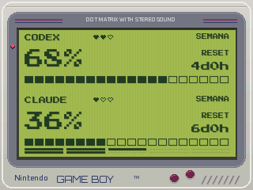
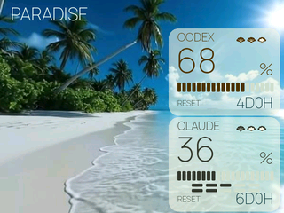
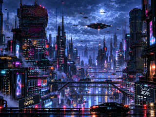
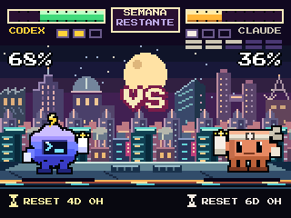
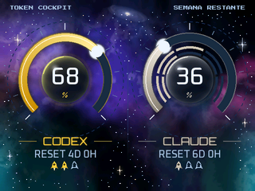

<div align="center">

# AI Desk Display

### Tus límites de IA, con bastante más personalidad que una barra de progreso.

Una Game Boy. Una ciudad cyberpunk. Una playa. Un combate entre Claude y Codex.
**Tu escritorio ya tenía suficientes números aburridos.**

[](pyproject.toml)
[](LICENSE)
[](#local-no-significa-magia)

[Descargar ZIP](https://github.com/TonyRod116/ai-desk-display/archive/refs/heads/main.zip) · [Ver las pantallas](#ocho-pantallas-cero-aburrimiento) · [Probar sin hardware](#pruébalo-sin-pantalla-ni-cuentas) · [Montarlo](#vale-lo-quiero-en-mi-escritorio) · [Hacerlo tuyo](#hazlo-tuyo-con-o-sin-ia)


*Capturas reales del renderizador. Cifras de ejemplo, ninguna cuenta personal.*

</div>

## ¿Qué es esto?

Una pequeña pantalla de escritorio que te enseña cuánto uso de **Claude y Codex** te queda, cuándo se renueva y, cuando la cuenta lo permite, cuántos resets guardados tienes.

La gracia está en cómo lo cuenta: las ventanas de una ciudad se apagan conforme gastas cuota, las barras de un juego de lucha bajan hasta el KO y una playa se mueve mientras tú intentas no mirar cuánto llevas consumido. No prometemos que te haga gastar menos. Que quede bonito, sí lo intentamos.

Nació como una personalización de [TokenTV](https://github.com/click6067-ship-it/token-tv), de **click6067-ship-it**, y terminó convirtiéndose en una colección de escenas animadas para una pantalla táctil ESP32. Aquí tienes el código del ordenador, el firmware y las herramientas para seguir jugando con él.

## Ocho pantallas, cero aburrimiento

| | |
|:---:|:---:|
| **Game Boy** · verde LCD, píxeles y nostalgia.<br> | **Paradise** · una escapadita tropical entre prompts.<br> |
| **Neon City** · luces de ciudad que representan tu cuota semanal.<br> | **Tidal Rush** · surf retro, tubo y ganas de vacaciones.<br> |
| **Token Run** · carretera con sabor a arcade.<br> | **Versus** · Claude contra Codex. A cero, KO.<br> |
| **Cockpit** · tu pequeño puesto de mando espacial.<br> | **Quota City** · edificios isométricos que reflejan lo que queda.<br> |

Las imágenes de arriba son estáticas; en la placa compatible hay coches voladores, olas, surf, carretera y otros movimientos. Las animaciones se ejecutan **en la placa**: el ordenador no tiene que subir una imagen nueva por cada fotograma.

### Un toque y cambias de mundo

En el firmware táctil incluido, las acciones se aplican al soltar:

| Gesto | Qué hace |
|---|---|
| Toque corto | Cambia de pantalla. |
| Mantener entre 2 y menos de 5 segundos | Alterna pantalla fija, rotación cada 30 minutos o cada hora. |
| Mantener 5 segundos o más | Abre la pantalla de conexión. |

La rotación sucede a las **:00 y :30**, o solo a las **:00**. Un indicador pequeño te recuerda el modo y la placa conserva la pantalla y el modo al reiniciar.

## Pruébalo sin pantalla ni cuentas

Solo necesitas Python 3.10 o superior. Esto genera las ocho escenas con **datos inventados**, sin iniciar sesión ni conectar ningún dispositivo:

```bash
git clone https://github.com/TonyRod116/ai-desk-display.git
cd ai-desk-display
python3 -m venv .venv
source .venv/bin/activate
pip install -e .
python scripts/render_gallery.py --out preview
```

Abre `preview/gallery.png`. Listo: ya tienes el pequeño multiverso en tu ordenador.

En Windows puedes crear el entorno con `py -m venv .venv` y activarlo con `.venv\Scripts\Activate.ps1`. Para la integración completa con lectores de cuentas, la instalación de referencia utiliza **Linux/WSL**; Windows nativo y macOS no tienen el mismo nivel de validación.

También puedes generar las caras clásicas del reloj:

```bash
token-tv demo --out preview/clock
```

El comando sigue llamándose `token-tv` para mantener compatibilidad con el proyecto original. No necesitas una clave API para ver las demos. La instalación sí descarga dependencias.

## Vale, lo quiero en mi escritorio

La experiencia de ocho escenas está preparada para una **ESP32-2432S028R / Cheap Yellow Display de 320×240**, con variantes de controlador ILI9341 y ST7789. También se conserva soporte para relojes GeekMagic, con sus propias limitaciones: no son la misma plataforma ni ejecutan este firmware ESP32.

1. Prueba primero la galería y comprueba el modelo exacto de tu pantalla.
2. Para la placa táctil, sigue la [guía de hardware](docs/hardware.md) y las [instrucciones del firmware](firmware/board/README.md). Flashear sustituye el programa que tenga la placa.
3. Configura tus propias cuentas y el dispositivo siguiendo la [guía de instalación](docs/setup.md). No hay cuentas, contraseñas ni emparejamientos preconfigurados.
4. Consulta las opciones con `token-tv --help` y `token-tv board --help`.

**Es un proyecto para trastear, no todavía un instalador de “siguiente, siguiente, terminado”.** Las consultas de uso dependen del cliente, el plan y los datos que exponga cada proveedor. El lector opcional de resets de Claude requiere [emparejar una extensión local](docs/claude-bank-local.md); esa parte es avanzada y puede necesitar ajustes si cambia el proveedor.

## Local no significa magia

- El ordenador prepara las escenas y envía los datos a la pantalla por tu red local. El panel de control escucha en localhost.
- Para obtener cifras nuevas, los lectores habilitados consultan los servicios oficiales de la cuenta. **“Local” no significa que las cuotas se puedan consultar sin Internet.**
- Necesitas el ordenador y el servicio funcionando para actualizar las lecturas. La placa anima lo que ya tiene, pero marca los datos como no disponibles si deja de recibir señales del ordenador.
- No hace falta dejar abierto este chat ni pedir a una IA que dibuje cada actualización.
- Un dato ausente se muestra como desconocido; no se inventa un cero. Los resets guardados tampoco se deducen del porcentaje.
- Usa la placa en una red de confianza: su conexión local es HTTP. No expongas sus puertos ni el panel a Internet.

## Hazlo tuyo, con o sin IA

**Este proyecto está hecho para que lo cambies.** Puedes pedirle a una IA que retoque colores, recolocar los porcentajes, diseñar otra escena o modificar las animaciones. Muchas de estas pantallas nacieron precisamente así: probando, mirando el resultado y diciendo “vale… pero más cyberpunk”.

También puedes usar la IA para **adaptarlo a otras pantallas**. El dibujo y el envío al dispositivo están separados, así que hay una buena base para cambiar la resolución o añadir otro método de conexión. Eso sí: no es compatible automáticamente con cualquier pantalla; según el hardware habrá que ajustar el controlador, el protocolo o el firmware.

Un buen primer encargo:

> “Lee AGENTS.md y el renderizador de Tidal Rush. Quiero cambiar la paleta a un atardecer violeta. Conserva los porcentajes, no accedas a mis cuentas y genera una previsualización con datos ficticios antes de tocar la placa.”

Otro, para los más aventureros:

> “Quiero adaptar estas escenas a mi pantalla de [modelo y resolución]. Revisa primero cómo se dibuja y cómo se envían las imágenes. Explícame qué se puede reutilizar y qué hay que implementar.”

Mapa rápido para orientarte:

| Quiero cambiar… | Mira aquí |
|---|---|
| Las escenas y su orden | `token_tv/board_pages.py` y `token_tv/board_*.py` |
| Las luces de la ciudad | `token_tv/board_neon_realistic.py` |
| Las animaciones de la placa | `token_tv/board_anim.py`, `token_tv/board_wave.py` y `firmware/board/` |
| Las caras del reloj clásico | [Crear una cara](docs/clock-faces.md) |
| La galería del README | `scripts/render_gallery.py` |

## ¿Has creado una pantalla chula?

Enséñala en un [issue](https://github.com/TonyRod116/ai-desk-display/issues). Una escena nueva, una adaptación a otro display o una mejora pequeña también cuentan. Si añades capturas, usa datos ficticios: tus cuentas no necesitan salir de excursión a GitHub.

Para ejecutar las pruebas locales:

```bash
python -m unittest discover -s tests
```

Algunas pruebas de firmware necesitan un compilador C++ y Node para las comprobaciones JavaScript. No ejecutes `scripts/e2e_live.py` como prueba rutinaria: está pensado para un dispositivo real.

## Créditos y licencia

Basado en **[TokenTV, de click6067-ship-it](https://github.com/click6067-ship-it/token-tv)**. Se conserva su aviso de copyright y su licencia MIT. Esta distribución añade escenas, animación nativa y mejoras de integración desarrolladas por Tony con ayuda de IA.

Código bajo [MIT](LICENSE). Las tipografías conservan sus licencias en `token_tv/web/`. Consulta [ASSETS.md](ASSETS.md) para la procedencia y condiciones de los recursos visuales. No es un producto oficial ni está afiliado a OpenAI, Anthropic, Nintendo o Atari.

Si acaba en tu escritorio, misión cumplida. 🌊
