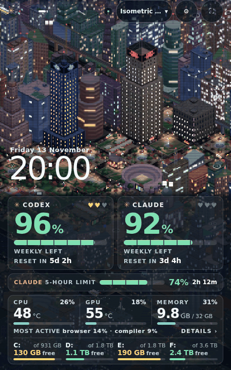
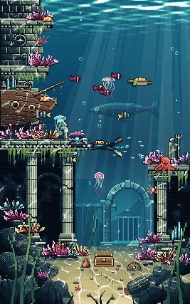
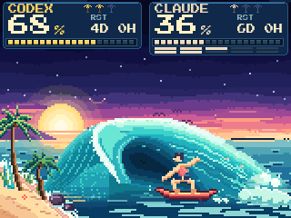
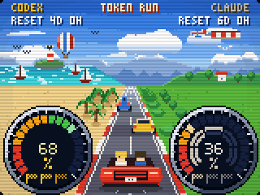

<h1 align="center">AI Desk Display</h1>

<p align="center">
  <strong>100% free, open-source desk display for your Claude &amp; Codex quotas — plus live PC vitals.</strong><br>
  Give an old tablet or a tiny ESP32 touchscreen a far better job than collecting dust.
</p>

<p align="center">
  <a href="LICENSE"></a>
  
  
  
</p>

<p align="center">
  <a href="#try-it-in-60-seconds">Try the 60-second demo</a> ·
  <a href="#put-it-on-your-desk">Install it for free</a> ·
  <a href="#one-old-tablet-zero-wasted-space">Tablet scenes</a> ·
  <a href="#eight-screens-zero-boredom">NerdMiner / ESP32</a>
</p>

> I bought a NerdMiner V2 hoping it would solo-mine a Bitcoin block. Spoiler: I hit my AI usage limits a *lot* more often than I find blocks. So I fired it from mining, rescued an old tablet from a drawer, and got slightly carried away building retro pixel-art worlds for my desk.

<p align="center">
  <a href="docs/images/tablet-city-quota.gif"></a>
</p>
<p align="center"><sub><b>Isometric City:</b> 1 lit window = 1% weekly quota left. Watch both towers go dark as your tokens evaporate. (The little helicopter does not judge your prompting habits. Probably.)</sub></p>

---

## Why put this on your desk?

| What you get | Why it’s actually useful |
| :--- | :--- |
| **Live AI quotas at a glance** | Weekly remaining **%** & reset countdowns for **Claude** and **Codex**, Claude’s **5-hour window**, **saved resets** when reported, and Codex **extra credits** when your week hits zero. No more tab-switching mid-flow. |
| **Live PC vitals on the dock** | CPU & GPU load and temps, RAM usage, free disk space, and top active apps — without sacrificing a monitor. |
| **One project, two desk toys** | Run it on any **old tablet** (browser or offline-ready Android app), a **NerdMiner V2 / ESP32 touchscreen**, or **both at once**. Also supports **GeekMagic SmallTV Ultra**. |
| **90s–2000s arcade & cozy worlds** | Tap the clock to enter **Picture Mode**, swipe scenes, sync lighting to sunrise/sunset & real weather, dim automatically at night, and get optional low-quota chimes. |
| **Built for real Wi-Fi** | Holds steady across brief hiccups instead of flashing blanks, and shows honest dashes if data is actually missing (unknown is *never* faked as `0%`). |
| **Actually free & 100% local** | **MIT-licensed**, zero subscriptions, zero cloud relay, zero extra API keys. Uses the Claude Code / Codex CLI logins already on your machine. |

---

## One old tablet, zero wasted space

Stand an old tablet upright on your desk, open the page (or install the optional Android app so scenes stay cached offline), and **tap the clock** whenever you want to hide the dock and enjoy **Picture Mode**.

<p align="center">
  <a href="docs/images/tablet-picture-tidal-rush.gif"></a>
  <a href="docs/images/tablet-tidal-rush.png"></a>
</p>
<p align="center"><b>Tidal Rush</b> — Picture mode &amp; live dashboard<br><sub>90s–2000s arcade barrel water at sunset. Your tokens may be sinking, but at least this guy is having a great day.</sub></p>

<p align="center">
  <a href="docs/images/tablet-isometric-weather.gif"></a>
  <a href="docs/images/tablet-picture-peaceful-house.gif"></a>
</p>
<p align="center"><b>Isometric City (live time &amp; weather) · Peaceful House</b></p>

<p align="center">
  <a href="docs/images/tablet-picture-token-run.gif"></a>
  <a href="docs/images/tablet-picture-blue-lightning.gif"></a>
</p>
<p align="center"><b>Token Run · Blue Lightning</b></p>

<p align="center">
  <a href="docs/images/tablet-picture-underwater.gif"></a>
  <a href="docs/images/tablet-picture-versus.gif"></a>
</p>
<p align="center"><b>Deep Blue · Versus</b></p>

<p align="center">
  <a href="docs/images/tablet-background-picker.png"></a>
</p>
<p align="center"><sub>Swipe between scenes, park on your favorite, rotate automatically, or let the time of day pick the vibe.<br>
<b>Tip:</b> try tapping the scenes too — they react! Poke the reef props, tap inside dark ruins to send the diver exploring, or see if you can actually tap one of the tiny fish (the little school scatters like you just interrupted their meeting).</sub></p>

---

## Eight screens, zero boredom

**Got a NerdMiner V2 or compatible ESP32 touchscreen?** Load up to **eight animated scenes**, tap to switch, or auto-rotate every 30 or 60 minutes.

In **Versus**, whoever runs out of quota literally gets **knocked out**. Turns out watching your AI get K.O.’d is a surprisingly effective reminder to go make coffee.

<p align="center">
  <a href="docs/images/game-boy.gif"></a>
  <a href="docs/images/paradise.gif"></a>
</p>
<p align="center"><b>Game Boy · Paradise</b></p>
<p align="center">
  <a href="docs/images/code-forge.gif"></a>
  <a href="docs/images/surf.gif"></a>
</p>
<p align="center"><b>Neon City · Tidal Rush</b></p>
<p align="center">
  <a href="docs/images/dials.gif"></a>
  <a href="docs/images/arcade.gif"></a>
</p>
<p align="center"><b>Token Run · Versus</b></p>
<p align="center">
  <a href="docs/images/cockpit.gif"></a>
  <a href="docs/images/countdown.gif"></a>
</p>
<p align="center"><b>Platform · City</b></p>

Use just the tablet, just the tiny screen, or run both together — the tablet even includes a remote control page to switch and reorder scenes in the [screen library](docs/board-control.md).

<sub>Previews use synthetic sample data. The weather clip speeds through a simulated day. A few scenes use optional local artwork you supply — see the [artwork notes](ASSETS.md).</sub>

---

## Try it in 60 seconds

**No hardware, no login, no account needed.** Spin up four live animated scenes (**Isometric City**, **Blue Lightning**, **Tidal Rush**, and **Deep Blue**) with sample data right in your browser. Requires Git and Python 3.10+ (on Windows, run inside Ubuntu/WSL).

```bash
git clone https://github.com/TonyRod116/ai-desk-display.git
cd ai-desk-display
python3 -m venv .venv
source .venv/bin/activate
pip install -e .

python scripts/prepare_game_city_iso.py --out preview/scenes --manifest
python scripts/prepare_game_blue_lightning_demo.py --out preview/scenes
python scripts/prepare_tidal_rush_dusk.py --out preview/scenes
python scripts/prepare_game_underwater.py --out preview/scenes --manifest
python scripts/sample_tablet.py --scenes preview/scenes
```

Then open **[http://127.0.0.1:18861/](http://127.0.0.1:18861/)**, tap the clock for Picture Mode, and switch scenes in the top bar.

Want a contact sheet of all tiny-screen scenes? Run `python scripts/render_gallery.py --out preview` and open `preview/gallery.png`.

---

## Put it on your desk

AI Desk Display is **completely free** — no paywalls, no accounts to create. Live numbers come directly from the Claude Code or Codex CLI you’re already signed into.

1. **Connect your PC** — Sign in to Claude Code, the Codex CLI, or both, and follow the [computer setup guide](docs/setup.md) to start the local monitor and readers.
2. **Pick your display:**
   - **Tablet:** follow the [tablet guide](docs/tablet.md) to connect over Wi-Fi, plus the optional [Android app](docs/tablet-app.md) if you want full-screen offline scene caching.
   - **ESP32 / NerdMiner V2:** check your exact board in the [hardware guide](docs/hardware.md) and flash via the [firmware guide](firmware/board/README.md) *(note: flashing replaces whatever was on the board, including the miner)*.
   - **GeekMagic SmallTV Ultra:** has [its own setup guide](docs/smalltv-ultra.md) — no firmware flashing required.

### Privacy & local network

Everything runs on **your own machine and local Wi-Fi**. The readers only talk to the official Claude/Codex endpoints, and optional outside weather uses Open-Meteo (with your location rounded and off by default). Use a trusted home network. Details in the [offline guide](docs/tablet-offline.md) and [network troubleshooting](docs/setup.md#troubleshooting).

---

## Make it yours

Want a different color palette, a custom retro scene, or support for some weird screen sitting in your closet? Point your favorite AI coding assistant at this repo and say:

> *“Fit this to my screen and show me a preview with sample data.”*

Check out the [tablet guide](docs/tablet.md) and [flight scene guide](docs/tablet-blue-lightning.md) for examples. If you get it running on something unexpected (or build a cooler scene), **[show it off in an issue](https://github.com/TonyRod116/ai-desk-display/issues)**!

---

<p align="center">
  Built by Tony with Claude Code and Codex · <a href="LICENSE">MIT License</a> · Inspired by <a href="https://github.com/click6067-ship-it/token-tv">TokenTV</a> · <a href="ASSETS.md">Artwork &amp; font credits</a>
</p>
