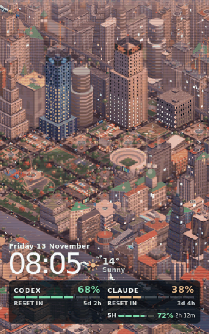

# AI Desk Display

**See what’s left of your Claude and Codex quota on an old tablet or a tiny touchscreen.**

I was waiting for my NerdMiner V2 to find a Bitcoin block. Turns out I hit my AI limits a lot more often. So I gave it a new job, dug out an old tablet, and got a little carried away with the backgrounds.

[Try the demo](#try-it-without-a-display-or-an-account) · [See the screens](#one-project-two-desk-toys) · [Set it up](#bring-it-to-your-desk)

<p align="center">
  
  
</p>
<p align="center"><sub>Isometric City on tablet · Versus on NerdMiner</sub></p>

See your **weekly quota remaining and reset times** at a glance, plus Claude’s five-hour window when available. Saved resets show up when the provider reports them, and Codex can show your extra credits after you’ve used up the weekly allowance. The tablet can also show the clock, CPU, GPU, memory and free disk space when your computer supplies those readings.

## One project, two desk toys

**Tablet.** Open it in a browser, set it upright and tap the clock to switch to picture mode. Swipe to change scenes or let them rotate on their own. Isometric City follows the time of day and can react to the weather. On days when the city feels a bit much, there’s a house by the sea.

<p align="center">
  
  
</p>
<p align="center"><b>Token Run · Peaceful House</b></p>
<p align="center">
  
  
</p>
<p align="center"><b>Blue Lightning · Tidal Rush</b></p>

### Eight screens, zero boredom

**NerdMiner V2 or compatible ESP32 touchscreen.** Pick eight scenes, tap to switch, or set them to rotate on the half hour or the hour. In Versus, the fighter who runs out of quota gets knocked out. I find this a surprisingly effective reminder to go make coffee.

<p align="center">
  
  
</p>
<p align="center"><b>Game Boy · Quota City</b></p>

Use either display on its own, or run both. The [screen library](docs/board-control.md) lets you pick and reorder scenes for the little one.

<sub>The GIFs show sample readings. The city preview speeds up time and simulates the weather. Some scenes use optional artwork you supply locally. See the [artwork notes](ASSETS.md).</sub>

## Try it without a display or an account

Play with two animated scenes and made-up usage on your computer. You’ll need Git and Python 3.10+. On Windows, run these commands inside Ubuntu/WSL.

```bash
git clone https://github.com/TonyRod116/ai-desk-display.git
cd ai-desk-display
python3 -m venv .venv
source .venv/bin/activate
pip install -e .

python scripts/prepare_game_city_iso.py --out preview/scenes --manifest
python scripts/prepare_game_blue_lightning_demo.py --out preview/scenes
python scripts/sample_tablet.py --scenes preview/scenes
```

Open [the local demo](http://127.0.0.1:18861/) and choose **Isometric City** or **Blue Lightning** in the scene picker. The demo runs without logging in or connecting any hardware. For a gallery of the tiny-screen scenes, run `python scripts/render_gallery.py --out preview` and open `preview/gallery.png`.

## Bring it to your desk

1. Sign in to Claude Code, the Codex CLI, or both on the computer that will send the readings. Follow the [computer setup guide](docs/setup.md) to start the monitor and the readers you need.
2. Pick your display. The [tablet guide](docs/tablet.md) gets you going over Wi-Fi, and the optional [Android app](docs/tablet-app.md) can keep scenery on the tablet for offline viewing. For a touchscreen board, check the [hardware guide](docs/hardware.md) for your exact model and follow the [firmware guide](firmware/board/README.md). Flashing replaces whatever is on the board, including the mining app on a NerdMiner.

Already have a GeekMagic SmallTV Ultra? It has [its own setup guide](docs/smalltv-ultra.md).

## The local part

The display runs on your local network. Keep the computer and readers running for fresh quotas and PC stats. The readers contact the official providers, and optional weather uses Open-Meteo. Use a trusted network for the board and tablet. See the [offline guide](docs/tablet-offline.md) and [network notes](docs/setup.md#troubleshooting).

## Make it yours

Try a new palette, invent a scene, or adapt the display to hardware you already have. You can ask an AI coding assistant to help. “Fit this to my screen and show me a preview with sample data” is a pretty good place to start. See the [tablet guide](docs/tablet.md) and the [flight scene guide](docs/tablet-blue-lightning.md) for examples.

If you get it running on something unexpected, I’d love to see it. [Share it in an issue](https://github.com/TonyRod116/ai-desk-display/issues).

Built by Tony with Claude Code and Codex. [MIT-licensed code](LICENSE), inspired by [TokenTV](https://github.com/click6067-ship-it/token-tv). [Artwork and font credits](ASSETS.md).
