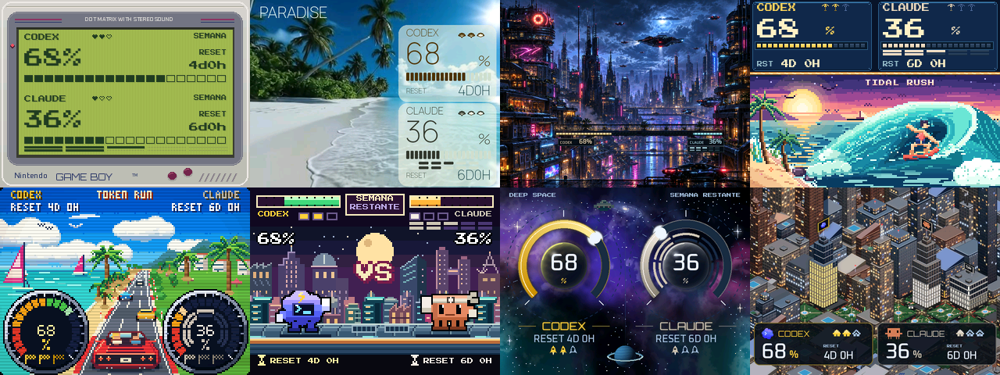
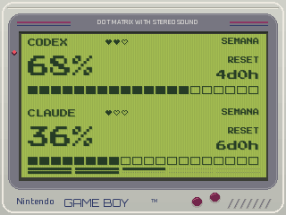
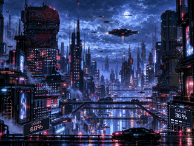
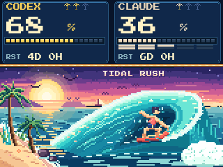
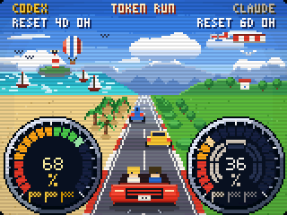
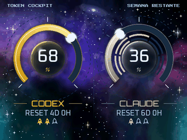
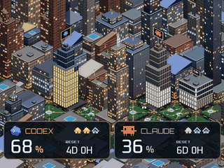

<div align="center">

# AI Desk Display

### Your AI limits deserve more personality than a progress bar.

A Game Boy. A cyberpunk city. A beach. Claude and Codex in a fighting game.
**Your desk already had enough boring numbers.**

[](pyproject.toml)
[](LICENSE)
[](#local-not-magic)

[Download ZIP](https://github.com/TonyRod116/ai-desk-display/archive/refs/heads/main.zip) · [Meet the screens](#eight-screens-zero-boredom) · [Try without hardware](#try-it-without-a-display-or-an-account) · [Build yours](#okay-i-want-this-on-my-desk) · [Make it your own](#make-it-yours-with-or-without-ai)



*Rendered by the actual app. Sample numbers, no personal accounts.*

</div>

## From lottery miner to quota watcher

I had a NerdMiner V2. Then I checked the odds: even giving it a generous **1 million hashes per second**, the illustrative average wait to find a Bitcoin block was about **19 billion years**.[^mining-math]

Turns out my patience wasn't covered by the warranty.

So I gave it a better job: watching my AI limits. At least those reset this week.

## What's this?

A small desk display that shows how much **Claude and Codex** usage you have left, when your limits reset and, where supported, how many saved resets are available.

The fun is in how it tells you: neon bridge lights retreat as you spend your quota, Claude and Codex face off on a moving train, and a surfer rides a foamy barrel while you try not to check how many tokens you've burned. We can't promise it'll make you use less AI. We're doing our best to make it look good, though.

**AI Desk Display** is a project by Tony, built with Claude Code and Codex: eight custom scenes, on-board animation, touch controls, timed screen rotation and local usage readers. It's designed around the **2.8-inch NerdMiner V2 touchscreen** (ESP32-2432S028R). This repo includes the host application, display firmware, artwork and tools to make it your own.

## Eight screens, zero boredom

| | |
|:---:|:---:|
| **Game Boy** · green LCD, pixels and nostalgia.<br> | **Paradise** · a tiny tropical break between prompts.<br> |
| **Neon City** · flying cars, neon bridges and a suspiciously useful skyline.<br> | **Tidal Rush** · ride the barrel, chase the foam, forget the next prompt.<br><br>[Still image](docs/images/surf.png) · [Under the hood](docs/board-surf.md) |
| **Token Run** · coastal cruising, approaching palms and a red convertible.<br><br>[Still image](docs/images/dials.png) · [Under the hood](docs/board-run.md) | **Versus** · a rooftop train fight with Claude and Codex. Empty quota? KO.<br><br>[Still image](docs/images/arcade.png) · [Under the hood](docs/board-versus.md) |
| **Cockpit** · deep space, ringed planets and the occasional UFO. Probably friendly.<br><br>[Still image](docs/images/cockpit.png) · [Under the hood](docs/board-cockpit.md) | **Quota City** · an isometric skyline that shows what's left.<br> |

These looping GIFs use **fictional readings**. Moving scenes, including Cockpit's UFO and stars, are captured from the firmware simulator. The Game Boy screen is normally static: its GIF demonstrates **accelerated sample quota updates**, not a constantly moving LCD. GIFs have a limited color palette; the display receives RGB565 frames.

On compatible hardware, animations run **on the board**. Your computer doesn't have to upload a new picture for every frame. Prefer still images? [Open the PNG gallery](docs/images/gallery.png).

Neon City's bridge is doing the accounting: **amber lights on the left for Codex, cyan on the right for Claude**. As weekly quota runs down, each strip retreats toward its outer end. Tiny signs show the exact percentages; Claude also gets two small five-hour bars. The buildings get to stay pretty. [See how it works, or grab the full-resolution artwork](docs/board-neon-city.md).

Token Run gets a little more road-trip energy: **resort palms grow closer and pass on the right**, while the nearby roadside scenery rushes past faster. No swaying back to where they started. Just a coastal drive, a red convertible and two AI quotas pretending to be dashboard instruments. The still, GIF and overview above show the updated scene. [Take the scenic route](docs/board-run.md).

### One tap, another world

With the included touch firmware, gestures take effect when you release:

| Gesture | What happens |
|---|---|
| Quick tap | Switch to the next screen. |
| Hold for 2 to less than 5 seconds | Cycle between fixed, every 30 minutes and every hour. |
| Hold for 5 seconds or more | Open the connection screen. |

Rotation happens at **:00 and :30**, or just **:00**. A tiny indicator shows the mode, and the board remembers your selected screen and mode after a restart.

## Try it without a display or an account

You'll need Python 3.10 or newer. These commands render all eight scenes with **made-up data**, without signing in or connecting to a device:

```bash
git clone https://github.com/TonyRod116/ai-desk-display.git
cd ai-desk-display
python3 -m venv .venv
source .venv/bin/activate
pip install -e .
python scripts/render_gallery.py --out preview
```

Open `preview/gallery.png`. Your tiny desk multiverse is ready to browse.

Want the animated previews too? With `g++` installed:

```bash
python scripts/render_animations.py --out preview
```

This runs the firmware animation simulator locally and writes GIFs. It doesn't contact your accounts or hardware.

On Windows, create the environment with `py -m venv .venv` and activate it with `.venv\Scripts\Activate.ps1`. The reference installation for the full account-reader integration uses **Linux/WSL**; native Windows and macOS have not received the same level of testing. WSL is also the simplest route for the C++ preview simulator on Windows.

You can also render the classic clock faces:

```bash
ai-desk-display demo --out preview/clock
```

No API key is needed for the demos. Installation does download dependencies.

## Okay, I want this on my desk

**Got a NerdMiner V2 with the 2.8-inch touchscreen? That's the display used in this project.** Your lottery miner might enjoy a career change, too.

The reference setup uses the **NerdMiner V2 touchscreen variant based on ESP32-2432S028R**, also known as the **Cheap Yellow Display (CYD), 320×240**. Firmware configurations are included for ILI9341 and ST7789 controllers. NerdMiner V2 also runs on other boards, so check the board model and display controller rather than relying on the NerdMiner name alone. Installing this firmware replaces the mining application.

Support for GeekMagic clocks is also retained, with different capabilities: they are not the same platform and do not run this ESP32 firmware.

1. Try the gallery and check your display's exact model.
2. For the touchscreen board, follow the [hardware guide](docs/hardware.md) and [firmware instructions](firmware/board/README.md). Flashing replaces whatever program is currently on the board.
3. Configure your own accounts and device using the [setup guide](docs/setup.md) *(currently in Spanish)*. No accounts, passwords or private pairing files are bundled.
4. Explore the options with `ai-desk-display --help` and `ai-desk-display board --help`.

**Updating an existing board?** Token Run's approaching resort palms need **firmware 14**, built from the source in this repo. Follow the [firmware guide](firmware/board/README.md); for a Wi-Fi update, hold the screen for five seconds and release to open the connection screen first. Older firmware gets a complete static Token Run image; the other seven scenes keep their existing animation.

**This is a tinkering project, not yet a “next, next, finish” installer.** Usage readings depend on the client, plan and information each provider exposes. Claude's optional saved-reset reader requires [pairing a local extension](docs/claude-bank-local.md); that's an advanced integration and may need adjustments when the provider changes things.

## Local, not magic

- Your computer renders the scenes and sends updates over your local network. The dashboard listens on localhost.
- Enabled account readers contact the official services for fresh numbers. **Local rendering doesn't mean you can fetch current quotas without Internet access.**
- Your computer and service need to be running to refresh readings. The board animates the scenes it already has, but marks data unavailable when it stops hearing from the host.
- You don't need to keep an AI chat open or ask an AI to draw each update.
- Missing data stays unknown. It isn't quietly turned into zero, and saved resets aren't guessed from your usage percentage.
- Keep the board on a trusted network: its local connection uses HTTP. Don't expose the board or dashboard ports to the Internet.

## Make it yours, with or without AI

**This project is meant to be changed.** Ask an AI to tweak the colors, rearrange the percentages, design another scene or adjust an animation. Many of these screens were built exactly that way: try something, look at it, then say “okay… but more cyberpunk.”

You can also use AI to **adapt it to other displays**. Rendering and device communication are separate, so there's a useful starting point for a different resolution or connection method. That doesn't make every display automatically compatible: depending on your hardware, you may need to adapt the driver, protocol or firmware.

A good first request:

> “Read AGENTS.md and the Tidal Rush renderer. I'd like a purple sunset palette. Keep the usage readings intact, don't access my accounts, and generate a preview with fictional data before touching the board.”

Feeling adventurous?

> “I'd like to adapt these scenes to my [model and resolution] display. First inspect the rendering and image-transfer code. Explain what can be reused and what needs to be implemented.”

A quick map:

| I want to change… | Start here |
|---|---|
| Scenes and their order | `token_tv/board_pages.py` and `token_tv/board_*.py` |
| Neon City artwork and bridge lights | `token_tv/board_neon_bridge.py` and [the scene guide](docs/board-neon-city.md) |
| Board animations | `token_tv/board_anim.py`, `token_tv/board_wave.py` and `firmware/board/` |
| Classic clock faces | [Make a face](docs/clock-faces.md) |
| README previews | `scripts/render_gallery.py` and `scripts/render_animations.py` |

## Made something cool?

Show it off in an [issue](https://github.com/TonyRod116/ai-desk-display/issues). A new scene, support for another display or a small improvement all count. Use fictional readings in your screenshots: your accounts don't need a field trip to GitHub.

Run the local tests with:

```bash
python -m unittest discover -s tests
```

Some firmware tests need a C++ compiler; JavaScript checks need Node. Don't run `scripts/e2e_live.py` as a routine test: it is intended for a real device.

## Credits and license

Created by **Tony**, with a lot of help from **Claude Code and Codex**. Original inspiration and some retained components: [TokenTV, by click6067-ship-it](https://github.com/click6067-ship-it/token-tv), whose MIT copyright notice is preserved in [LICENSE](LICENSE).

Code is licensed under [MIT](LICENSE). Fonts retain their license files in `token_tv/web/`. See [ASSETS.md](ASSETS.md) for visual-asset provenance and permissions. This is not an official product and is not affiliated with OpenAI, Anthropic, Nintendo or Atari.

If it ends up on your desk, mission accomplished. 🌊

[^mining-math]: Back-of-the-envelope estimate checked on 2026-10-23: Bitcoin difficulty **140,577,680,051,919.6**, from [mempool.space's mining API](https://mempool.space/api/v1/mining/hashrate/3d). Expected years ≈ `difficulty × 2^32 ÷ hashes_per_second ÷ 31,557,600` = **19.13 billion** at an assumed **1 MH/s**. That's a generous illustrative rate, not a measurement of this board; modified CYD firmware [reports roughly 990 kH/s](https://github.com/HenrysCat/NerdMiner-Modded). The calculation assumes continuous operation and unchanged difficulty forever. It's a statistical mean, not a countdown, guarantee or prediction: a lucky block could arrive sooner, and future difficulty changes the odds. [Solo mining wins a block reward plus fees](https://developer.bitcoin.org/devguide/mining.html#solo-mining), not exactly 1 BTC. The network figure above is a dated snapshot; the linked API changes over time.
