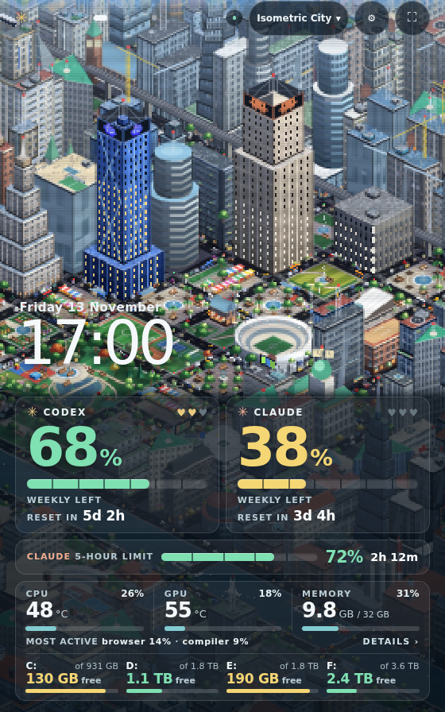
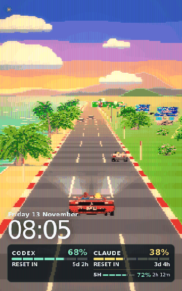
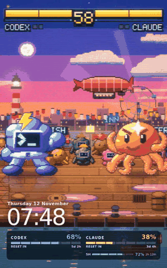
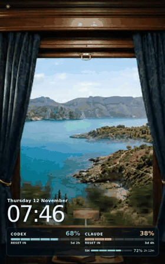
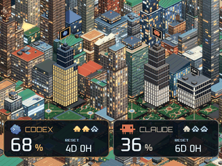

# AI Desk Display

### Your AI limits deserve a better screen.

Turn an old tablet, a tiny touchscreen, or another display into an animated home for your **Claude and Codex usage**.

[Try the demo](#try-it-without-a-display-or-an-account) · [Choose your screen](#one-project-two-desk-toys) · [Set it up](#bring-it-to-your-desk) · [Make it yours](#make-it-yours)

**Isometric City** · **Tidal Rush**

I had a NerdMiner V2 on my desk. Its chances of finding a Bitcoin block were… let's call them *character-building*. So I gave it a new job: telling me when I'm about to run out of AI instead.

Then an old tablet joined in. Then I made a few screens. Then a few more. You know how these things go.

## Your quota, with a view

- **Know what's left:** see weekly Claude and Codex usage remaining and their reset times, plus Claude's five-hour window when available. Percentages mean **remaining**, not used.
- **See the extras:** saved resets appear when the provider reports them. A confirmed positive credit balance can replace the percentage after the weekly quota is exhausted. If a reading isn't available, it stays unknown.
- **Keep an eye on your PC:** the tablet can also show CPU and GPU readings, memory, multiple drives, time and date. Sensor availability depends on your hardware and operating system.
- **Let it live:** switch scenes, rotate them automatically, use picture mode, or add your own photos. The two displays have independent settings.

In **Isometric City**, windows show remaining quota while traffic, boats, helicopters and little city stories carry on around them. The light follows the time of day; if you enable weather, the city can react to clouds, rain and other conditions. The GIF above speeds up the day and uses simulated weather, because waiting until sunset makes for a rather long README.

## One project, two desk toys

**A tablet.** Use it on its own, in portrait, with the dashboard or picture mode. Tap the clock to enjoy the scenery, swipe to change scenes, and double-tap to open the scene picker. The Android app can save prepared scenes for offline viewing.

  
  
  
  

<b>Dashboard</b> · <b>Token Run</b> · <b>Versus</b> · <b>Infinite Express</b>

**A little touchscreen.** A compatible ESP32 touchscreen can show animated scenes and cycle through eight selected screens. Many NerdMiner V2 devices use the ESP32-2432S028R / Cheap Yellow Display family, but check your exact board and display controller first.

### Eight screens, zero boredom

  
  
  
  

<b>Game Boy</b> · <b>Versus</b> · <b>Token Run</b> · <b>Quota City</b>

Tap the small screen to change scenes; hold for two seconds to cycle rotation between off, 30 minutes and one hour; hold for five seconds to open the connection screen. Compatible firmware lets you adjust the hold times. The [screen library](docs/board-control.md) lets you preview, reorder and swap scenes from your computer.

**Neither device requires the other.** Have a different display? Start with the version closest to yours and adapt it. More on that [below](#make-it-yours).

All quota and computer readings in these previews are fictional. The Isometric City time and weather are accelerated and simulated. Some previews use optional custom artwork that is not included in the repository; see [artwork notes](ASSETS.md).

## Try it without a display or an account

You can explore the local demos with made-up data before connecting anything. You'll need Python 3.10+ and Git:

~~~bash
git clone https://github.com/TonyRod116/ai-desk-display.git
cd ai-desk-display
python3 -m venv .venv
source .venv/bin/activate
pip install -e .

# Draw the public Isometric City, then open the fictional tablet demo
python scripts/prepare_game_city_iso.py --out preview/scenes --manifest
python scripts/sample_tablet.py --scenes preview/scenes
~~~

Open **http://127.0.0.1:18861/**. No provider account or hardware is contacted. On Windows, use <code>py -m venv .venv</code> and activate it with <code>.venv\Scripts\Activate.ps1</code>; the full setup is tested mainly on Linux/WSL. For a still gallery of the small-screen scenes, run <code>python scripts/render_gallery.py --out preview</code> and open <code>preview/gallery.png</code>.

## Bring it to your desk

Install the project as above, sign in to the official Claude Code and/or Codex CLI clients you use, and follow the [computer setup](docs/setup.md). Then choose whichever display you want:

- **Tablet:** follow the [tablet guide](docs/tablet.md) to connect over your Wi-Fi. A browser works; the [Android app](docs/tablet-app.md) adds saved scenes, fullscreen and certificate pinning. No small board required.
- **Small touchscreen:** check the [hardware guide](docs/hardware.md), [firmware instructions](firmware/board/README.md) and [pairing guide](docs/setup.md#2-connect-the-touchscreen-board). Flashing replaces whatever is currently on the board, including a mining app.

Using a **GeekMagic SmallTV Ultra**? That's a separate integration: [see its guide](docs/smalltv-ultra.md). If your board's address keeps changing, reserve its IP in your router; that's a DHCP reservation, not port forwarding. The project doesn't automatically install startup services. [Troubleshooting and startup notes](docs/setup.md#troubleshooting).

## The local part

The display and dashboard run locally. Enabled usage readers still contact the **official providers**; optional weather uses Open-Meteo and is off by default. The small board uses local HTTP, and automatic discovery can share its pairing token with devices on the local subnet. Keep it on a trusted network and don't expose it to the internet.

Fresh quotas and computer stats need the computer and readers running. The Android app can keep its saved scenery, clock and display settings when the computer is off; it does not save live quotas or PC readings in its scene cache. [Offline details](docs/tablet-offline.md) · [Network and setup details](docs/setup.md#troubleshooting).

Your credentials, pairing information, private settings and optional source artwork are not in this repository. Some scenes require you to supply your own permitted artwork; no game ROMs or separate extracted game sprites are included. [What is and isn't included](ASSETS.md).

## Make it yours

Change the colours. Invent a scene. Make a quiet display for your office, or a tiny city that judges your token habits. You can do it by hand or ask an AI coding assistant to help. For example:

> Adapt the tablet display to my device and resolution. Keep the usage readings intact and show me a preview with fictional data.

Different hardware may need a driver, firmware changes and testing. The [tablet guide](docs/tablet.md), [small-screen guide](docs/board-control.md) and source are good places to start.

Built by **Tony**, with plenty of help from **Claude Code and Codex**. If you make something fun, share it in an [issue](https://github.com/TonyRod116/ai-desk-display/issues) — preferably without your real account data in the screenshot.

Code: [MIT](LICENSE). Inspired by [TokenTV](https://github.com/click6067-ship-it/token-tv), whose attribution is retained in the license. Fonts and artwork have their own [notes](ASSETS.md); provider and hardware names belong to their respective owners.
