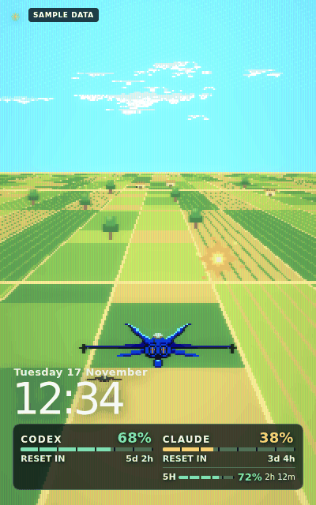
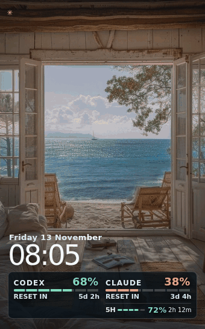
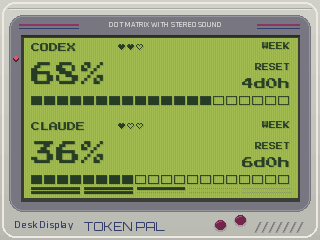
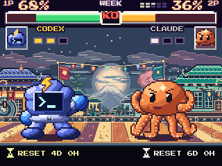

# AI Desk Display

### Your AI limits deserve a better screen.

Turn an old tablet, a tiny touchscreen, or another display into an animated home for your **Claude and Codex usage**.

[Try the demo](#try-it-without-a-display-or-an-account) · [Pick your screen](#one-project-two-desk-toys) · [Set it up](#bring-it-to-your-desk) · [Make it yours](#make-it-yours)

**Isometric City** · **Tidal Rush**

I had a NerdMiner V2 on my desk. Its chances of finding a Bitcoin block were… let's call them *character-building*. So I gave it a new job: telling me when I'm about to run out of AI instead.

Then an old tablet joined in. Then I made a few screens. Then a few more. You know how these things go.

## Your quota, with a view

- **See what's left.** Weekly Claude and Codex usage, their reset times, and Claude's five-hour window when available. The percentages show **remaining**, not used.
- **Spot the extras.** Saved resets appear when a provider reports them. After Codex's weekly quota is exhausted, a confirmed positive credit balance can replace the percentage. Missing data stays unknown.
- **Watch your computer.** The tablet can also show CPU and GPU readings, memory, multiple drives, time and date. Available sensors depend on your hardware and operating system.
- **Pick the mood.** Change scenes, rotate them automatically, try picture mode or add your own photos. The two displays have independent settings.

Isometric City has a little life of its own: windows show remaining quota while traffic, boats, helicopters and city stories carry on around them. Its light follows the time of day and, if you enable weather, it can react to the conditions outside. The GIF above uses accelerated time and simulated weather; waiting for actual sunset made for a rather long README.

## One project, two desk toys

**A tablet.** Use a portrait tablet on its own, with the dashboard or picture mode. Tap the clock to enjoy the scenery, swipe to change scenes, and double-tap to open the scene picker. The optional Android app can keep prepared scenes on the tablet for offline viewing.

  
  

<b>Dashboard</b> · <b>Token Run</b>

  
  

<b>Blue Lightning</b> · <b>Peaceful House</b>

  
  

<b>Versus</b> · <b>Infinite Express</b>

**A little touchscreen.** A compatible ESP32 touchscreen can show animated scenes and cycle through eight selected screens. Many NerdMiner V2 devices use the ESP32-2432S028R / Cheap Yellow Display family, but check your exact board and display controller first.

### Eight screens, zero boredom

  
  
  
  

<b>Game Boy</b> · <b>Versus</b> · <b>Token Run</b> · <b>Quota City</b>

Tap the small screen to change scenes. Hold for two seconds and release to cycle rotation between off, 30 minutes and one hour; hold for five seconds and release to open the connection screen. Compatible firmware can adjust those hold times. From the computer, the [screen library](docs/board-control.md) lets you preview, reorder and swap scenes.

**Use either display, or both.** Neither needs the other. If yours is different, start with the closest version and [adapt it](#make-it-yours).

All readings in these previews are fictional. Isometric City's time and weather are accelerated and simulated. Some GIFs show optional custom artwork whose source files are not included; see the [artwork notes](ASSETS.md).

## Try it without a display or an account

Want to look around first? The local demos use made-up data and don't contact your accounts or hardware. You'll need Python 3.10+ and Git:

~~~bash
git clone https://github.com/TonyRod116/ai-desk-display.git
cd ai-desk-display
python3 -m venv .venv
source .venv/bin/activate
pip install -e .

# Prepare two fictional tablet scenes and open the demo
python scripts/prepare_game_city_iso.py --out preview/scenes --manifest
python scripts/prepare_game_blue_lightning_demo.py --out preview/scenes
python scripts/sample_tablet.py --scenes preview/scenes
~~~

Open **http://127.0.0.1:18861/**. On Windows, run the commands above inside Ubuntu/WSL; the demo currently requires the Linux environment rather than native Windows Python.

For a still gallery of the small-screen scenes, run <code>python scripts/render_gallery.py --out preview</code> and open <code>preview/gallery.png</code>.

## Bring it to your desk

Install the project as above, sign in to the official Claude Code and/or Codex CLI clients you use, and start with:

~~~bash
ai-desk-display setup
ai-desk-display doctor
~~~

Then follow the [computer setup guide](docs/setup.md) to enable the readers and keep the monitor running. Choose whichever display suits your desk:

- **Tablet:** follow the [tablet guide](docs/tablet.md) to connect over your trusted Wi-Fi. A browser works; the [Android app](docs/tablet-app.md) adds saved scenes, fullscreen and certificate pinning. No small board required.
- **Small touchscreen:** check the [hardware guide](docs/hardware.md), [firmware instructions](firmware/board/README.md) and [pairing guide](docs/setup.md#2-connect-the-touchscreen-board). Flashing replaces the program on the board, including a mining app.

Using a **GeekMagic SmallTV Ultra**? That's a different integration: [see its guide](docs/smalltv-ultra.md). If the board keeps changing address, a DHCP reservation in your router can keep its local IP stable. That's not port forwarding. [Troubleshooting and startup notes](docs/setup.md#troubleshooting).

## The local part

The dashboard and display run locally. Enabled usage readers still contact the **official providers** for fresh readings; optional weather uses Open-Meteo and is off by default. The small board uses local HTTP, and automatic discovery can share its pairing token with devices on the local subnet. Use a trusted network and don't expose it to the internet.

Fresh quotas and computer stats need the computer and readers running. The Android app can keep its saved scenery, clock and display settings when the computer is off; it does not save live quotas or PC readings in its scene cache. The repository does not install startup services automatically. [Offline details](docs/tablet-offline.md) · [Network and setup details](docs/setup.md#troubleshooting).

Your credentials, pairing information, private settings and optional source artwork are not in this repository. Some scenes need artwork you have permission to use; game ROMs and separately extracted game sprites are not included. [What is and isn't included](ASSETS.md).

## Make it yours

Change the colours. Invent a scene. Make a quiet display for your office, or a tiny city that judges your token habits. You can do it yourself or ask an AI coding assistant to help. For example:

> Adapt the tablet display to my device and resolution. Keep the usage readings intact and show me a preview with fictional data.

Other hardware may need a driver, firmware changes and testing. The [tablet guide](docs/tablet.md), [flight scene guide](docs/tablet-blue-lightning.md), [small-screen guide](docs/board-control.md) and source are good places to start.

Built by **Tony**, with plenty of help from **Claude Code and Codex**. If you make something fun, share it in an [issue](https://github.com/TonyRod116/ai-desk-display/issues) — preferably without your real account data in the screenshot.

Code: [MIT](LICENSE). Inspired by [TokenTV](https://github.com/click6067-ship-it/token-tv), whose attribution is retained in the license. Fonts and artwork have their own [notes](ASSETS.md); provider and hardware names belong to their respective owners.
