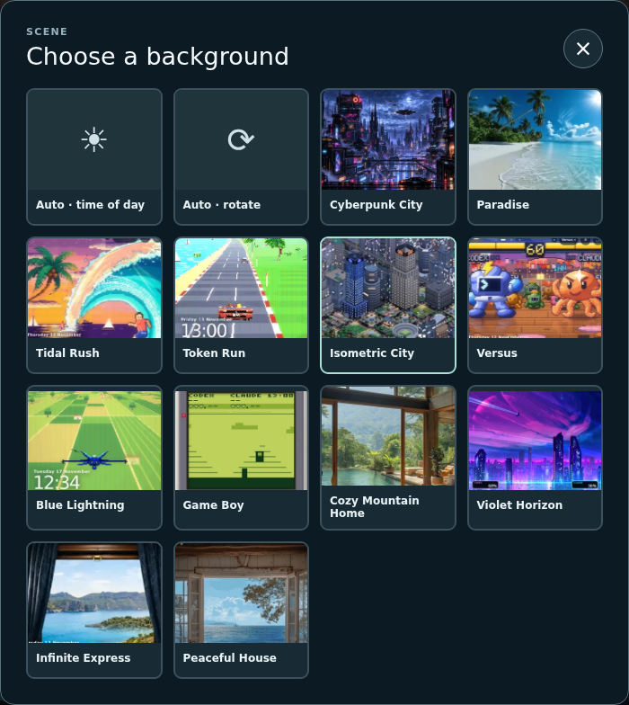
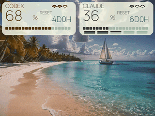
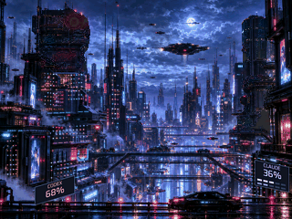
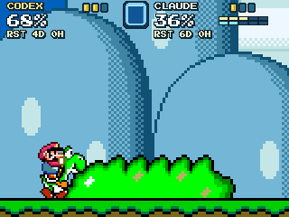

# AI Desk Display

**A free, open-source display for your Claude and Codex quota.** Give an old tablet or a tiny touchscreen a second life.

I was waiting for my NerdMiner V2 to find a Bitcoin block. Turns out I hit my AI limits a lot more often. So I gave it a new job, dug out an old tablet, and got a little carried away with the backgrounds.

[Install it for free](#bring-it-to-your-desk) · [Try it without an account](#try-it-without-a-display-or-an-account)

<p align="center">
  <a href="docs/images/tablet-city-quota.gif"></a>
</p>
<p align="center"><sub>One lit window is 1% of the weekly quota left. Watch both towers go dark with the sample readings.</sub></p>

In **Isometric City**, the Claude and Codex towers double as quota bars. As you use up your weekly allowance, windows go dark. The city follows the time of day and can react to the weather if you turn it on. The little helicopter has no opinion about your token habits. Probably.

You can also see **what’s left this week and when it resets**, plus Claude’s five-hour window when available. Saved resets show up when the provider reports them, and Codex can show extra credits when the weekly allowance runs out. The tablet dashboard also fits in CPU and GPU load and temperatures, memory, and free disk space when your computer supplies those readings.

## One project, two desk toys

**Tablet.** Open it in a browser, set it upright and tap the clock to switch to picture mode. Swipe to change scenes or let them rotate on their own. **Peaceful House** can go from sunrise to moonlight once you’ve prepared its time-of-day backgrounds. Over in **Tidal Rush**, the waves are having a considerably busier day.

<p align="center">
  
  
</p>
<p align="center"><b>Isometric City after hours · Peaceful House</b></p>
<p align="center">
  
  
</p>
<p align="center"><b>Token Run · Blue Lightning</b></p>

<p align="center">
  <a href="docs/images/tablet-picture-tidal-rush.gif"></a>
  <a href="docs/images/tablet-tidal-rush.png"></a>
</p>
<p align="center"><b>Tidal Rush · Picture mode and dashboard</b></p>

<p align="center">
  <a href="docs/images/tablet-background-picker.png"></a>
</p>
<p align="center"><sub>Choose which scenes to keep in the tablet’s library.</sub></p>

### Eight screens, zero boredom

**NerdMiner V2 or compatible ESP32 touchscreen.** Load up to eight scenes and pick which ones to include. Tap to switch, or set them to rotate on the half hour or the hour. In Versus, the fighter who runs out of quota gets knocked out. I find this a surprisingly effective reminder to go make coffee.

<p align="center">
  <a href="docs/images/game-boy.gif"></a>
  <a href="docs/images/paradise.gif"></a>
</p>
<p align="center"><b>Game Boy · Paradise</b></p>
<p align="center">
  <a href="docs/images/code-forge.gif"></a>
  <a href="docs/images/surf.gif"></a>
</p>
<p align="center"><b>Neon City · Tidal Rush</b></p>
<p align="center">
  <a href="docs/images/dials.gif"></a>
  <a href="docs/images/arcade.gif"></a>
</p>
<p align="center"><b>Token Run · Versus</b></p>
<p align="center">
  <a href="docs/images/cockpit.gif"></a>
  <a href="docs/images/countdown.gif"></a>
</p>
<p align="center"><b>Platform · City</b></p>

Use either display on its own, or run both. The [screen library](docs/board-control.md) lets you pick and reorder scenes for the little one.

<sub>The previews show sample readings. The weather clip runs through a simulated day. Some scenes use optional artwork you supply locally. See the [artwork notes](ASSETS.md).</sub>

## Try it without a display or an account

Play with three animated scenes and made-up usage on your computer. You’ll need Git and Python 3.10+. On Windows, run these commands inside Ubuntu/WSL.

```bash
git clone https://github.com/TonyRod116/ai-desk-display.git
cd ai-desk-display
python3 -m venv .venv
source .venv/bin/activate
pip install -e .

python scripts/prepare_game_city_iso.py --out preview/scenes --manifest
python scripts/prepare_game_blue_lightning_demo.py --out preview/scenes
python scripts/prepare_tidal_rush_dusk.py --out preview/scenes
python scripts/sample_tablet.py --scenes preview/scenes
```

Choose **Isometric City**, **Blue Lightning** or **Tidal Rush** in the scene picker. [Open the local demo](http://127.0.0.1:18861/)

For a gallery of the tiny-screen scenes, run `python scripts/render_gallery.py --out preview` and open `preview/gallery.png`.

## Bring it to your desk

AI Desk Display is free to install and use. For live readings, it uses your existing Claude or Codex account.

1. Sign in to Claude Code, the Codex CLI, or both on the computer that will send the readings. Follow the [computer setup guide](docs/setup.md) to start the monitor and the readers you need.
2. Pick your display. The [tablet guide](docs/tablet.md) gets you going over Wi-Fi, and the optional [Android app](docs/tablet-app.md) can keep scenery on the tablet for offline viewing. For a touchscreen board, check the [hardware guide](docs/hardware.md) for your exact model and follow the [firmware guide](firmware/board/README.md). Flashing replaces whatever is on the board, including the mining app on a NerdMiner.

Already have a GeekMagic SmallTV Ultra? It has [its own setup guide](docs/smalltv-ultra.md).

## The local part

The display runs on your local network. Keep the computer and readers running for fresh quotas and PC stats. The readers contact the official providers, and optional weather uses Open-Meteo. Use a trusted network for the board and tablet. See the [offline guide](docs/tablet-offline.md) and [network notes](docs/setup.md#troubleshooting).

## Make it yours

Try a new palette, invent a scene, or adapt the display to hardware you already have. You can ask an AI coding assistant to help. “Fit this to my screen and show me a preview with sample data” is a pretty good place to start. See the [tablet guide](docs/tablet.md) and the [flight scene guide](docs/tablet-blue-lightning.md) for examples.

If you get it running on something unexpected, I’d love to see it. [Share it in an issue](https://github.com/TonyRod116/ai-desk-display/issues).

Built by Tony with Claude Code and Codex. [MIT-licensed code](LICENSE), inspired by [TokenTV](https://github.com/click6067-ship-it/token-tv). [Artwork and font credits](ASSETS.md).
