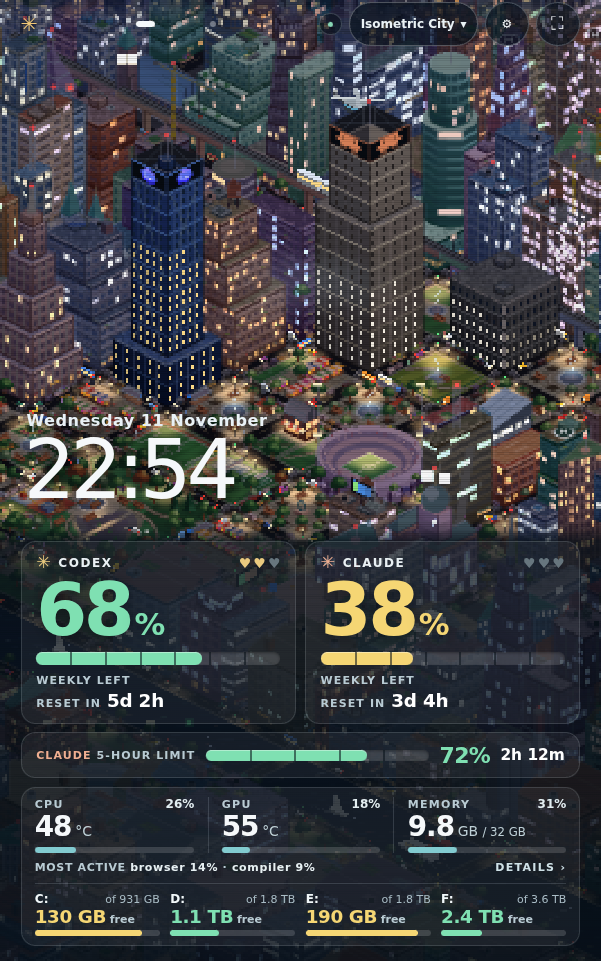
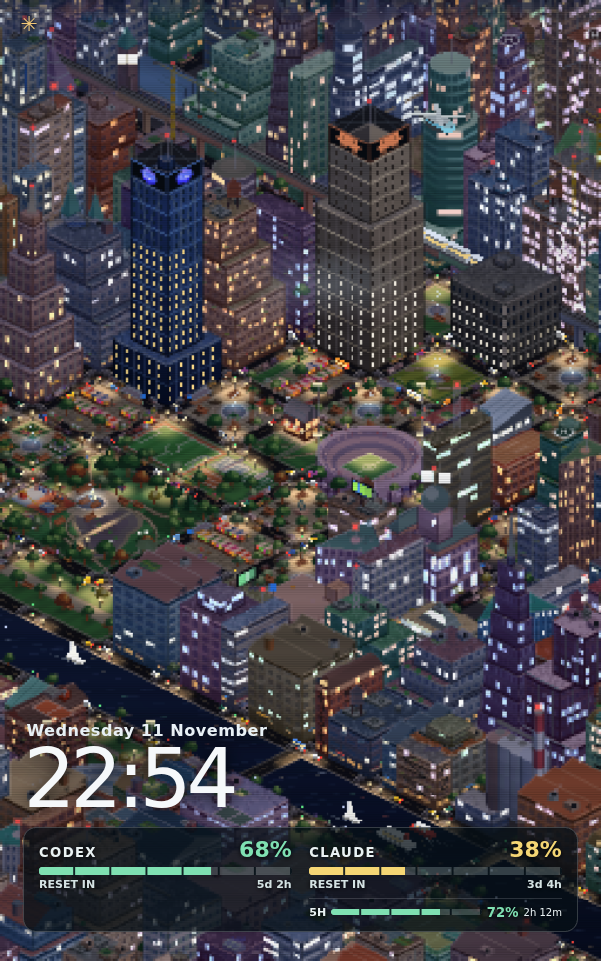
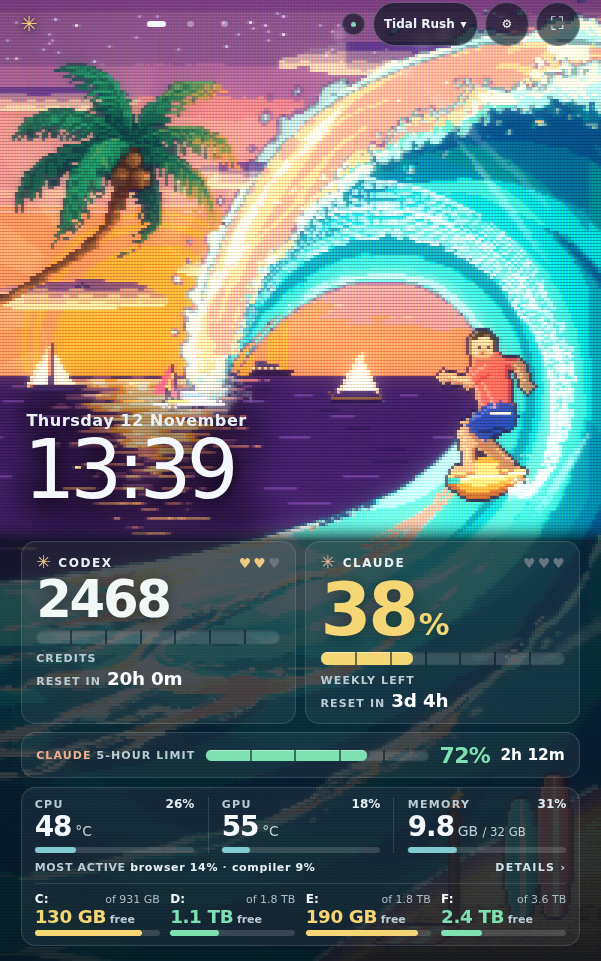
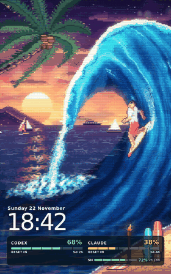
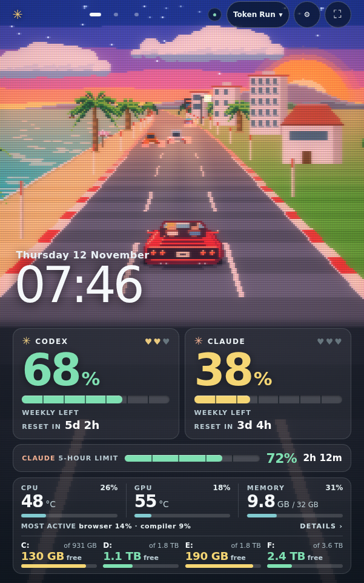
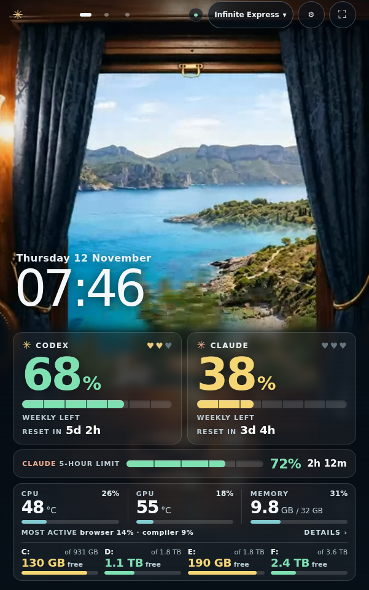
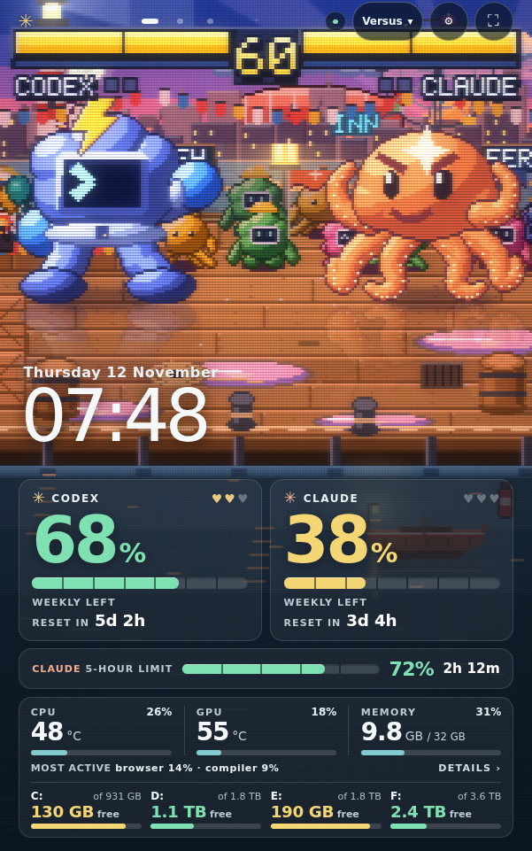

<div align="center">

# AI Desk Display

### Your AI limits called. They want a better screen.

A tiny animated display for **Claude and Codex usage** — with a tablet companion for the days when tiny just isn't big enough.

[](pyproject.toml)
[](LICENSE)
[](#local-not-magic)

[Download](https://github.com/TonyRod116/ai-desk-display/archive/refs/heads/main.zip) · [Tiny screens](#eight-screens-zero-boredom) · [Tablet](#an-old-tablet-gets-a-new-job) · [Try it](#try-it-without-a-display-or-an-account) · [Setup](#okay-i-want-this-on-my-desk) · [Make it yours](#make-it-yours-with-or-without-ai)

</div>

I had a NerdMiner V2 on my desk. After calculating that finding a Bitcoin block might take an *average* of about **19 billion years** at a generous 1 MH/s,[^mining-math] I decided to give it a less demanding career.

Now it tells me when I'm running out of AI. Honestly, more useful.

## What does it show?

- **Claude and Codex:** weekly usage remaining and when it resets, plus Claude's five-hour limit when available.
- **Saved resets:** up to three hearts when the provider reports a balance. Codex extra credits appear when the weekly allowance is exhausted and a verified balance is available.
- **Your computer, on the tablet:** CPU and GPU usage and temperatures, memory, multiple drives, time and date. There's optional weather and alerts for low quota, renewed limits and low disk space.

Some readings depend on your plan, clients and hardware. If something is missing or stale, the display says so instead of inventing a reassuring number. Claude's saved-reset balance needs an [optional local browser extension](docs/claude-bank-local.md).

## Eight screens, zero boredom

Pick eight for the little display. Change them whenever your attention span demands it.

| | |
|:---:|:---:|
| **Game Boy**<br> | **Paradise**<br><br>*Optional artwork* · [Setup](docs/board-paradise.md) |
| **Tidal Rush**<br> | **Token Run**<br> |
| **Versus**<br>Run out of quota? KO.<br> | **Platform World**<br><br>*Optional artwork* · [Setup](docs/board-platform.md) |
| **Neon District**<br><br>*Optional artwork* | **Quota City**<br> |

There's also [Hyrule Quest](docs/board-quest.md), older designs and more in the library. **All numbers in these previews are fictional.** Some show optional artwork that isn't included; no ROMs or separate extracted game sprites are shipped. Paradise and Platform World have bundled alternatives. The Game Boy GIF simulates updates, and the Paradise GIF shows an earlier wave. [Artwork notes](ASSETS.md).

## An old tablet gets a new job

Got an old Android tablet? It can show the same AI limits, your computer stats and animated scenes in portrait. Tap the clock for **picture mode**, swipe between scenes, or double-tap to pick one. Weekly bars have seven divisions; Claude's five-hour bar has five.

The tablet can rotate scenes by time of day, show your photos and control the little display remotely. It has its own settings, so it won't rearrange the board while you're busy admiring the scenery.

| Tablet dashboard | Picture mode |
|:---:|:---:|
| **Isometric City**<br> | **Isometric City**<br> |
| **Tidal Rush**<br> | **Tidal Rush · animated**<br> |
| **Token Run**<br> | **Token Run · animated**<br> |
| **Infinite Express**<br> | **Infinite Express · animated**<br> |
| **Versus**<br> | **Versus · animated**<br> |

*Fictional readings, real animations. Tidal Rush and Infinite Express use optional custom artwork; Versus shows the bundled original stage.* [See the four-scene tour](docs/images/tablet-picture-mode-scenes.gif) · [Tablet setup](docs/tablet.md).

## A screen library, not just eight slots

On your computer, open **http://127.0.0.1:8787/board** while the monitor is running. Preview screens, bring back old favourites, drag the eight slots into order, adjust speed and touch holds, or rotate every **30 minutes or hour**. When the clock is synced, changes happen on the half hour or hour. Compatible firmware remembers your settings.


The computer's **Usage dashboard** can show any available scene without changing the board. Both computer pages have English and Spanish. [Control room guide](docs/board-control.md).

### One tap, another world

Default touchscreen gestures happen when you **release** your finger:

| Gesture | What happens |
|---|---|
| Tap | Next screen. |
| Hold 2 seconds | Cycle rotation: off, 30 minutes, 1 hour. |
| Hold 5 seconds | Open the connection screen. |

The hold times can be changed on compatible firmware. Five seconds also opens the physical gate for a Wi-Fi firmware update. [Details](docs/board-control.md).

## Try it without a display or an account

Python 3.10+ is enough to try a gallery and a tablet demo with **made-up data**:

```bash
git clone https://github.com/TonyRod116/ai-desk-display.git
cd ai-desk-display
python3 -m venv .venv
source .venv/bin/activate
pip install -e .
python scripts/render_gallery.py --out preview  # open preview/gallery.png
python scripts/sample_tablet.py                  # open http://127.0.0.1:18861/
```

On Windows, use `py -m venv .venv` and `.venv\Scripts\Activate.ps1`. The full reader setup is tested mainly on Linux/WSL; native Windows and macOS have had less testing. Want animated board previews too? The [setup notes](docs/setup.md) and [scene guides](docs/board-surf.md) have the details.

## Okay, I want this on my desk

**For the little screen:**

1. Check your hardware: the reference is the 2.8-inch **ESP32-2432S028R / Cheap Yellow Display**, used by many NerdMiner V2 boards. Other NerdMiners exist. Flashing replaces the mining app, so follow the [hardware](docs/hardware.md) and [firmware](firmware/board/README.md) guides for your controller.
2. Install the project as above and sign in to the official Claude Code and/or Codex CLI clients you use. Run `ai-desk-display setup`, then follow the [setup guide](docs/setup.md) to pair the board and start the readers and monitor.
3. Open **http://127.0.0.1:8787**, choose your screens and enjoy your new, slightly judgemental desk companion.

**For a tablet:** open the [tablet guide](docs/tablet.md), start the tablet service and connect over the same Wi-Fi using its HTTPS address and password. A browser works; the [optional Android app](docs/tablet-app.md) adds full screen, screen-on behaviour and certificate pinning. Compare the certificate fingerprint before trusting it.

**Got a GeekMagic SmallTV Ultra?** That's a different integration, not the touchscreen firmware. See the [SmallTV guide](docs/smalltv-ultra.md).

### Keep the connection steady

Reserve the board's IP address in your router (a **DHCP reservation**) so it doesn't wander off after a restart. This is not port forwarding. If you see `NO DATA`, check power, Wi-Fi, the monitor and readers; the [setup guide](docs/setup.md#troubleshooting) walks through it. The repository doesn't install automatic startup for you; see the [Windows/WSL notes](docs/windows-startup-local.md) if you want it.

## Local, not magic

- Rendering and the computer dashboard are local. Enabled readers still contact the **official providers**; optional weather contacts Open-Meteo when enabled.
- The computer and monitor must be running for fresh readings. The board can keep animating stored scenes, but old data becomes unavailable.
- The board uses unencrypted HTTP on your local network. Use a trusted network and don't expose its ports to the Internet. Automatic rediscovery can send the pairing token to devices on the saved subnet; [read the details](docs/setup.md#troubleshooting).
- Your accounts, credentials, pairing files and optional source artwork are yours. They aren't included in the repository.

## Make it yours, with or without AI

Change colours, invent a scene or ask an AI to help: *“Read the Tidal Rush renderer, give it a purple sunset, keep the readings intact and show me a preview with fictional data.”* That's pretty much how this project acquired more screens than anyone strictly needs.

AI can also help adapt it to another display, although a new resolution, connection or device may need its own driver or firmware. Test on the actual hardware. Start with the [control room guide](docs/board-control.md), `token_tv/board_*.py` or the [tablet guide](docs/tablet.md).

Made something cool? Share it in an [issue](https://github.com/TonyRod116/ai-desk-display/issues) — with fictional readings, please. Run `python -m unittest discover -s tests` for the Python checks; some also need a C++ compiler, and the JavaScript checks use Node.

## Credits and license

Made by **Tony**, with a lot of help from **Claude Code and Codex**. Inspired by and retaining some components from [TokenTV](https://github.com/click6067-ship-it/token-tv); its MIT notice is in [LICENSE](LICENSE). Code is [MIT](LICENSE); fonts and artwork have their own [notes](ASSETS.md). This independent project isn't affiliated with the providers or hardware and game makers mentioned above.

[^mining-math]: Illustration checked on 2026-10-23: difficulty **140,577,680,051,919.6** from [mempool.space](https://mempool.space/api/v1/mining/hashrate/3d), assuming **1 MH/s** continuously and unchanged difficulty: `difficulty × 2^32 ÷ hashes_per_second ÷ 31,557,600` ≈ **19.13 billion years**. It's a statistical mean, not a countdown or guarantee; difficulty changes and a lucky block could arrive sooner. The assumed rate is not a measurement of this board. A solo miner wins a block reward plus fees, not exactly 1 BTC.
