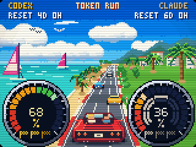

# Token Run

A little coastal arcade escape for your desk: a red convertible, three lanes,
turquoise water, palms, windsurf sails and a seaside resort. The coast and road
share a horizon, and the shoreline reaches toward you alongside the asphalt.
The car has round tail lamps, mirrors, deck louvres and two riders enjoying a
considerably better commute than yours.




The scene is original art drawn locally in Python/Pillow, inspired by the
composition and colors of [SEGA's Out Run](https://archives.sega.jp/segaages/outrun/).
It includes no game sprites, screenshots, music or game code.

## The useful bits

The two dials show **weekly quota remaining**: Codex on the left, Claude on the
right. Twenty outer blocks run from red through amber to green as more quota
becomes available. The three chequered flags are saved resets, not extra quota;
a small dot marks unknown or old reset inventory. Claude's two inner rings show
its five-hour quota and time remaining when those readings are available.
Unknown usage stays unknown.

The road, kerbs, lane marks, palms and reflector posts advance in perspective.
Three cars hold their lanes ahead, while the convertible settles slightly on
its suspension. Resort palms now **keep approaching**: they grow, move outward
and leave the right edge while the next trees arrive from the distance. No
back-and-forth drift. Eight perspective poses make a 1.92-second cycle, slower
than the 0.48-second road cycle but four times quicker than the previous drift.
The fixed palm above the left sea stays gone. The gull, static clouds, water
glints, gentle CRT treatment and hard 2×2 pixels keep their established look.
Only the small distant parasol remains; the two foreground parasols are gone,
leaving a clear path for the approaching palms. The animation itself is unchanged.

## Try it locally

The scenery lives in `token_tv/board_drive.py`; the dials and scoreboard live in
`token_tv/board_dials.py`. Render every screen with fictional readings:

```bash
python scripts/render_gallery.py --out preview
python scripts/render_animations.py --out preview
```

Open `preview/dials.png` or `preview/dials.gif`. The animated preview runs the
actual firmware engine locally and needs `g++`; it doesn't contact an account
or a display. Its 120 ms sampling matches the stored scene's native cadence;
the GIF spans the complete 3.84-second joint loop of the road, palms and gull.

**The approaching palms require firmware 14.** Its four sprite slots accept eight
poses each and an 80,000-byte ANIM payload. Token Run uses 77,648 bytes, with a
231,264-byte complete page. The road stays at 120 ms; resort palms update every
240 ms. Two adjoining palm crops keep restoration away from the road and all
quota pixels. Nothing is streamed from the PC to animate, and animation writes
nothing to flash.

The host checks the board's `anim_frames: 8` capability. Earlier boards get a
complete static Token Run image; the other seven screens retain their animation.
Use the [normal firmware update process](../firmware/board/README.md), including
the physical five-second hold and release to open the connection screen. Pairing
and that physical gate remain mandatory.

Page uploads and verified readback allow up to 60 seconds per socket operation:
animation-heavy scenes can take longer than the former 20-second limit. Control
requests keep their 20-second limit. Pairing, no-proxy routing and byte-for-byte
verification are unchanged.

Tests check the coast, seamless loop, quota masks, sprite restoration bounds,
static fallback and size limits, and run the real C++ engine with sanitizers.
See the [screen gallery](../README.md#eight-screens-zero-boredom) and
[hardware guide](hardware.md) for the other scenes and supported boards.
