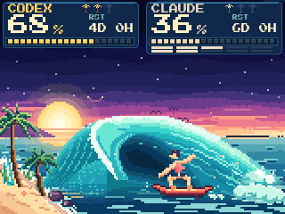

# Tidal Rush



A small tribute to handheld surfing games: a planted board, a surfer balancing inside the barrel, and water flowing down the wave into breaking foam on the right. Staggered foam billows rise, spread and fade while gulls cross the sky. The composition stays steady so the readings remain easy to read.

Codex and Claude show **weekly quota remaining**. Claude's smaller five-hour meter and reset countdowns stay separate. Missing readings are shown as unknown, not an empty quota.

The surfer and wave follow a **4.8-second loop** with 150 ms beats; individual pieces can use up to eight poses. Compatible boards animate the surfer, wave and foam locally. Firmware with extended animation also adds two gulls with a longer cycle. The host does not query accounts or stream a new picture for each frame; older firmware receives a still image.

Start in `token_tv/board_surf.py`. Preview the actual renderer and animation engine with fictional data:

```bash
python scripts/render_gallery.py --out preview
python scripts/render_animations.py --out preview
```

The GIF generator needs `g++`. [Full-color still](images/surf.png) · [All eight screens](../README.md#eight-screens-zero-boredom) · [Hardware guide](hardware.md).
