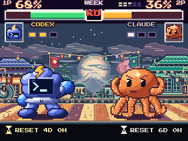

# Versus · the arcade fight

Codex and Claude face off in a pixel-art arena inspired by 1990s fighting games.
The animation below uses fictional readings and the bundled stage.

The health bars show weekly allowance remaining: green when there's plenty,
amber in the middle and red when it's running low. A fighter falls when a
verified weekly allowance reaches zero. Unknown quota is shown as unknown,
never as an empty bar or a knockout. The small bars beneath the names represent
saved resets; Claude's two narrow meters also show the five-hour session and
time left when those readings are available. Weekly reset times sit along the
bottom of the scene. Verified extra credits can replace Codex's percentage
when its weekly allowance is exhausted.

The distinct fighters use whole-body idle stances, while the stage and ambient
details animate locally on supported boards. The computer supplies the readings;
it does not need to stream each frame. Screen refreshes preserve the animation
where the firmware supports it. A previous **Night Train** version remains
available in the [screen library](board-control.md).

The included arena works on its own. You may optionally supply a different
local stage and ambient art; no game graphics are shipped or downloaded. If the
optional files are missing or invalid, the display falls back to the bundled
scene. Use assets you have permission to use. Place an RGB `stage.png`
(320 × 240) and two sets of four transparent RGBA frames in
`~/.local/share/ai-desk-display/arcade-local/`: `ambient-0-0.png` through
`ambient-0-3.png` (25 × 14 each), and `ambient-1-0.png` through
`ambient-1-3.png` (27 × 14 each). The effects have fixed positions, so they
need to be composed for the chosen stage.
