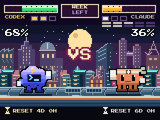

# Versus: rooftop rumble



Claude and Codex face off on a broad metal train roof. Planted feet and small breathing/guard movements keep the fighting-game stance; the city does the traveling. Two layers of moving buildings have their own silhouettes, windows, signs and rooftop details. Stars fill the sky, with an occasional shooting star.

The health bars show **weekly quota remaining**: green above 50%, amber from above 20% through 50%, and red at 20% or less. A fresh reading of zero leaves that fighter KO on the roof. An unavailable reading never triggers a KO. Three small bars show saved resets where that information is available.

Four native poses run at **160 ms** intervals. Each city layer moves at a different speed and wraps after a complete cycle. Compatible firmware animates locally, without a new account request or image upload for each frame; older firmware receives a still image.

Start in `token_tv/board_arcade.py`. Generate previews with fictional readings:

```bash
python scripts/render_gallery.py --out preview
python scripts/render_animations.py --out preview
```

The GIF generator needs `g++`. [Full-color still](images/arcade.png) · [All eight screens](../README.md#eight-screens-zero-boredom) · [Hardware guide](hardware.md).
