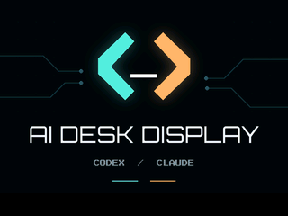

# AI Desk Display firmware

Runs eight AI Desk Display scenes on an ESP32 touch board (Cheap Yellow Display,
ESP32-2432S028R, 320×240), with native animation, touch navigation and wall-clock
rotation. The host sends rendered pages over the local network. The board holds
no provider accounts or credentials and never contacts AI services itself.

## Build (isolated toolchain, nothing global)

    python3 -m venv ~/code/tools/pio-venv && ~/code/tools/pio-venv/bin/pip install platformio
    cd firmware/board
    PLATFORMIO_CORE_DIR=~/code/tools/pio-core ~/code/tools/pio-venv/bin/pio run -e cyd          # ILI9341
    PLATFORMIO_CORE_DIR=~/code/tools/pio-core ~/code/tools/pio-venv/bin/pio run -e cyd_st7789   # ST7789

Merge one image per variant (flash at offset 0), as the web flasher expects:

    P=~/code/tools/pio-core/packages
    ~/code/tools/pio-venv/bin/python $P/tool-esptoolpy/esptool.py --chip esp32 merge_bin \
      -o dist/tokentv-board-cyd.bin --flash_mode dio --flash_freq 40m --flash_size 4MB \
      0x1000 .pio/build/cyd/bootloader.bin 0x8000 .pio/build/cyd/partitions.bin \
      0xe000 $P/framework-arduinoespressif32/tools/partitions/boot_app0.bin 0x10000 .pio/build/cyd/firmware.bin

## Flash

The web flasher is vendored (no internet needed): `npm pack esp-web-tools@10.4.0`, copy `package/dist/web/*.js`
to `flasher/vendor/esp-web-tools/`, then

    python3 -m http.server 8790 --bind 127.0.0.1 --directory firmware/board

and open `http://127.0.0.1:8790/flasher/` in Chrome or Edge with the board on USB.

## Protocol (the PC calls these)

| Call | Token | Purpose |
|---|---|---|
| `GET /info` | no | model, firmware, page slots, `active` (slots cycled), `paired`, `stars` (can twinkle a page's stars), `anim` (`ANIM` sprites), `waves` (`WAVE` photographic ocean), `wave_us`/`wave_max_us` (last/maximum ocean frame microseconds), plus uptime, last reset reason, taps, wifi signal, PC silence and current page |
| `POST /pair?token=<16 hex>` | only if already paired | an unpaired board is claimed by the first caller (the PC chooses the token) |
| `POST /update` multipart `file` | yes **and** address screen showing | install a firmware image (`firmware.bin`) over the wifi |
| `POST /page?n=0..7` multipart `file` | yes | store page n (`TVF1` + w,h u16 LE + RGB565 LE, then optional `STAR`, `ANIM` or `WAVE`; at most 194568 bytes) |
| `GET /page?n=` | yes | read it back (the PC verifies every upload) |
| `POST /ping` | yes | heartbeat, answers one character per page (`1` = stored); without one for 3 minutes the board shows SIN DATOS |
| `POST /show?n=` | yes | select a page |
| `POST /config?rotation=1\|3&invert=0\|1&swaprb=0\|1&swapbytes=0\|1&pages=1..8` | yes | panel options and how many page slots are cycled, kept across reboots |

The PC chooses the token and claims an unpaired board, so reflashing needs nothing typed.

## Touch and wall-clock rotation (firmware 10)

Actions happen on release: a short tap advances one page; 2 to less than 5 seconds
cycles fixed → 30 minutes → 1 hour → fixed; 5 seconds or more opens the address
screen (and arms the existing authenticated firmware-update gate). Holding longer
never deletes pairing. While held, a small hint indicates the action on release.
A mode confirmation lasts two seconds. A tap on the address screen returns to the
selected page. The eight-second unpair gesture from earlier builds is removed.

A dim 29×9-pixel bottom-left indicator shows pause, a divided circle with `30m`,
or a whole circle with `1h`; the circle fills toward the next boundary. A tiny dot
means the board is waiting for its first clock synchronization. The selected page
and mode are stored in NVS only when they change. On boot the initial heartbeat
restores the saved page; the PC does not force page one on firmware advertising
`selection_memory: true`. Normal stale-data hiding remains in force.

The existing authenticated heartbeat adds `?clock=<local-civil-seconds>`: the PC's
Unix timestamp plus its current UTC offset. No NTP or external clock service.
Thirty-minute mode advances at :00/:30, hourly mode at :00. Manual taps do not
move those boundaries. No rotation while info/update/stale/touch is active, and
no catch-up burst after resuming. Initial synchronization and clock jumps over
five seconds (including timezone/DST changes) re-anchor without advancing a page;
minor corrections cannot repeat a boundary. The monotonic counter handles wrap.
`/info` exposes `rotation_minutes`, `clock_synced`, and `selection_memory`.

Earlier firmware ignores the heartbeat query and still accepts the PC client.
A firmware-10 board accepts old heartbeats but leaves timed rotation waiting until
it receives a timestamp. This changes neither quota queries nor account access.

## Panel colours

The panel of the reference board shows a photographic negative unless the display is inverted, so the firmware
defaults to inverted (`TOKENTV_INVERT_DEFAULT`, stored value `inv` in NVS overrides it). To diagnose any
other panel, push a screen of named colour swatches and compare: complementary colours mean `--invert 1`,
only red and blue swapped means `--swap-rb 1`, scrambled colours mean `--swap-bytes 1`.

## Boot splash

`tools/make_splash.py` draws the local terminal-inspired splash with Pillow and the bundled fonts,
and writes `src/splash_data.h`: a 256-colour palette plus run-length data,
streamed row by row at boot. Firmware 13 shows **AI DESK DISPLAY** beneath the
cyan/amber terminal chevrons, and **AI Desk Display** on the connection screen.
Use `--preview /tmp/ai-desk-display-splash.png` to inspect the 320×240 artwork.
This changes no connection behavior, boot delay, saved settings or rotation controls.
Edit the drawing and run the script again; keep the band y >= 214 empty, the firmware writes its status
line there. The application slot is 1 MB and the image uses about 92 % of it, so check `pio run` before
adding bigger art.

Firmware 12 also polls touch between page upload/read chunks, using the same 10 ms
poll gate as the main loop. A transfer retains its own file handle when touch changes
the visible page; no recursive HTTP handling or touch during firmware update.
The native slow-transfer harness reproduces lost taps and verifies tap, mode and
connection gestures without corrupting payloads. Its latency bound is simulated,
not a claim about every physical Wi-Fi or flash stall.

The first board page now uses `token_tv/board_gameboy.py`: a grey DMG-style
landscape casing around a green recessed LCD. Weekly quotas/reset text remain
large, with saved-reset hearts and the two Claude session bars. Only the board
320x240 page changes; the clock and web Game Boy faces remain unchanged. The LCD
uses a faint vertical-only grid to avoid the previously observed shimmer.
