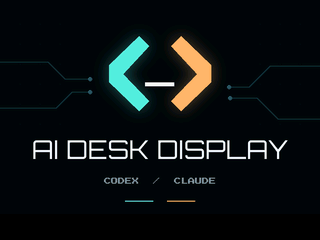

# AI Desk Display firmware

Runs eight AI Desk Display scenes on an ESP32 touch board (Cheap Yellow Display,
ESP32-2432S028R, 320×240), with native animation, touch navigation and wall-clock
rotation. The host sends rendered pages over the local network. The board holds
no provider accounts or credentials and never contacts AI services itself.

The [local control room](../../docs/board-control.md) lets you choose a scene,
animation speed, automatic rotation and touch timings from your computer.

## Recent capabilities (firmware 42–44)

The newer animation format supports up to eight animated elements and longer
sequences, used by scenes such as Tidal Rush and Violet Horizon. The display
continues to animate locally; the computer sends readings and page updates.
The local control room can also schedule a dimmer backlight at night.

A newly installed build is treated as a trial. Once it has run long enough and
received an authenticated heartbeat, it is marked as confirmed; repeated trial
failures can return it to the previously confirmed partition. A watchdog helps
recover from an unresponsive firmware loop. These measures are not a substitute
for a stable power supply. Update over Wi-Fi only while the paired board's
physical connection screen is open.

## Build (isolated toolchain, nothing global)

    python3 -m venv ~/code/tools/pio-venv && ~/code/tools/pio-venv/bin/pip install platformio
    cd firmware/board
    PLATFORMIO_CORE_DIR=~/code/tools/pio-core ~/code/tools/pio-venv/bin/pio run -e cyd          # ILI9341
    PLATFORMIO_CORE_DIR=~/code/tools/pio-core ~/code/tools/pio-venv/bin/pio run -e cyd_st7789   # ST7789

Prepare the files expected by the USB flasher and the Wi-Fi update command.
From `firmware/board`, after building both variants above:

```bash
mkdir -p dist
for variant in cyd cyd_st7789; do
  cp ".pio/build/$variant/bootloader.bin" "dist/tokentv-board-$variant-bootloader.bin"
  cp ".pio/build/$variant/partitions.bin" "dist/tokentv-board-$variant-partitions.bin"
  cp ".pio/build/$variant/firmware.bin" "dist/tokentv-board-$variant-firmware.bin"
done
cp ~/code/tools/pio-core/packages/framework-arduinoespressif32/tools/partitions/boot_app0.bin dist/boot_app0.bin
```

If you use a different PlatformIO core directory, use its `packages` folder
instead. The `dist/` files are generated locally and are not in the repository.
The application image ending in `-firmware.bin` is also what `board --update`
uses; choose `--variant cyd_st7789` when updating that screen type.

## Flash

The source checkout does not bundle esp-web-tools. With Node and npm installed,
prepare its pinned web files locally (this step downloads the package):

```bash
web_tools_dir="$(mktemp -d)"
npm pack esp-web-tools@10.4.0 --pack-destination "$web_tools_dir"
tar -xzf "$web_tools_dir/esp-web-tools-10.4.0.tgz" -C "$web_tools_dir"
mkdir -p flasher/vendor/esp-web-tools
cp -R "$web_tools_dir/package/dist/web/." flasher/vendor/esp-web-tools/
cp "$web_tools_dir/package/LICENSE" flasher/vendor/esp-web-tools/LICENSE
```

From the repository root, serve the prepared page and firmware locally:

```bash
python3 -m http.server 8790 --bind 127.0.0.1 --directory firmware/board
```

Open `http://127.0.0.1:8790/flasher/` in Chrome or Edge with the board connected
directly over USB. The page and built images are served by your computer. For
Wi-Fi updates, keep the board paired and first open its physical connection
screen; see the [setup guide](../../docs/setup.md).

## Protocol (the PC calls these)

| Call | Token | Purpose |
|---|---|---|
| `GET /info` | no | model, firmware, page slots, `active` (slots cycled), `paired`, `stars`, `anim`, `anim_frames` (maximum stored poses), `anim_active` (engine loaded), `free_heap`, `waves`, `wave_us`/`wave_max_us`, `scroll`, `scroll_us`/`scroll_max_us`/`scroll_frames`, plus uptime, last reset reason, taps, wifi signal, PC silence and current page |
| `POST /pair?token=<16 hex>` | only if already paired | an unpaired board is claimed by the first caller (the PC chooses the token) |
| `POST /update` multipart `file` | yes **and** address screen showing | install a firmware image (`firmware.bin`) over the wifi |
| `POST /page?n=0..7` multipart `file` | yes | store page n (`TVF1` + w,h u16 LE + RGB565 LE, then optional `STAR`, `ANIM`, `WAVE` or `SCRO`; at most 235528 bytes) |
| `GET /page?n=` | yes | read it back (the PC verifies every upload) |
| `POST /ping` | yes | heartbeat, answers one character per page (`1` = stored); without one for 3 minutes the board shows NO DATA |
| `POST /show?n=` | yes | select a page |
| `POST /config?rotation=1\|3&invert=0\|1&swaprb=0\|1&swapbytes=0\|1&pages=1..8` | yes | panel options and how many page slots are cycled, kept across reboots |

The PC chooses the token and claims an unpaired board, so reflashing needs nothing typed.

## Photographic ocean (firmware 22–23)

Boards advertising `waves:1` animate the entire photographed sea at native
resolution, including the water behind the transparent readings. The original
photo, text and dry sand remain fixed; incoming foam advances and retreats in a
6.4-second loop. The board stores one compact texture and renders locally, with
no video streaming or per-frame flash writes. Older firmware continues using the
existing smaller surf animation.

Firmware 23 separates the motion into independent, broken foam crests that
travel shorewards, gentler open-water ripples and the advancing shoreline.
The crest animation is periodic across the loop boundary; the first loaded
still remains the original photograph until its animation begins.

Firmware 30 adds intermediate water positions and reduces the work needed for
each frame. The water and boat keep their existing loop durations and speed;
the actual frame rate depends on the display and any ongoing page transfer.
If memory is tight, the renderer falls back to the original color calculations.

Firmware 32 reduces storage reads by caching as much of the unchanged beach
background as fits while reserving 80 KiB of heap at allocation time. The
board retries later if there is temporarily not enough memory, and the
full-resolution file remains the fallback if the cache cannot be loaded. The
`wave_cache_rows` and `wave_read_us`/`wave_compose_us`/`wave_push_us`/
`wave_boat_us`/`wave_loop_us`/`wave_indicator_us` fields report the cached
height and timing breakdown, in microseconds, to help diagnose performance on
actual hardware.
`wave_cache_status` reports 0 for untried, 1 for insufficient memory budget,
2 for allocation failure, 3 for seek failure, 4 for read failure, and 5 for
success; `wave_cache_free` and `wave_cache_largest` capture heap conditions at
the last attempt.

During a page transfer, ocean redraws are limited to one every 200 ms, and
holding the touchscreen pauses them so the physical controls remain usable.
Navigation and rotation indicators are redrawn after each ocean frame. The
`wave_us` and `wave_max_us` fields report measured frame time on the device;
simulation alone does not establish smoothness on the physical panel. Firmware
updates still require the paired token and the five-second connection screen.

Firmware 14 accepts up to eight poses per sprite and an 80,000-byte ANIM payload.
Token Run uses this for continuously approaching resort palms: eight perspective
poses at 240 ms, alongside the unchanged four road poses at 120 ms. Its 77,648-byte
payload remains stored locally and runs without PC streaming or flash writes.
The host checks `anim_frames: 8`; earlier firmware receives a complete static
Token Run page, while the other seven scenes retain their existing animation.
Update through the normal paired, physical connection-screen gate. No erase,
account access or pairing reset is needed.

## Optional private artwork (firmware 20)

Boards advertising `scroll:3` accept an additional 66,964-byte `SCRO` format,
with eight 28 × 32 rider poses displayed at double size, locally supplied
sprites and clean block backgrounds. It remains
below the existing 80,000-byte limit and supports both earlier formats. No game
assets are shipped or fetched by the project. If the optional private files are
missing or invalid, the host sends the previous scene instead. See
[`docs/board-platform.md`](../../docs/board-platform.md) for the local format.
The physical five-second connection-screen gate still applies to firmware updates.

## Closer platform scene (firmware 19)

Boards advertising `scroll:2` receive a second `SCRO` variant: the same indexed
world format with five 48 × 54 rider poses and a closer camera. The local
compositor uses a continuous jump over each enemy, a second hop that bumps a
block from below, and a short coin animation. It wraps after 23.04 seconds and
keeps the scoreboard untouched. The 76,116-byte payload stays below the
80,000-byte animation limit. Firmware 19 also accepts the original `scroll:1`
payload; the PC continues sending it to firmware 17–18. The physical five-second
connection-screen gate remains required for any firmware update.

## Smoother platform scrolling (firmware 29)

The zoomed platform formats keep their original timeline but add one-pixel
positions every 15 ms. The camera and jump do not run faster, and the actor stays outside
the block before the hit. Repeated landscape rows are composed once and pushed
in 16-row bands. Frame timing remains limited by the physical panel and is
reduced during transfers; the finer positions do not guarantee a particular fps. `scroll_frames` counts
frames since the current scrolling page was loaded for on-device measurements.
Older unzoomed scenes keep their 60 ms cadence and all formats remain unchanged.

## Smoother platform scrolling (firmware 18)

The same `SCRO` data works on both firmware 17 and 18. Firmware 18 draws an
intermediate camera position every 60 ms, preserving travel speed and the loop,
and reduces repeated page-dot storage lookups. During page transfer it budgets
the scrolling redraws to at most one per 100 ms and services touch in between.
This reduces contention while allowing the scene to keep moving. One physical
board measured approximately 30 ms per redraw, below the 60 ms frame interval;
perceived smoothness and transfer performance still depend on the device.

## Platform scrolling (firmware 17)

The optional `SCRO` trailer holds a 512 × 96 indexed landscape, terrain heights,
and four small rider poses. The board composes 8-row bands every 120 ms beneath
the unchanged scoreboard. The periodic landscape wraps without a camera jump,
and its phase survives page redraws. No per-frame transfer, flash write, provider
query, or extra account access is involved. Invalid payloads fail closed to the
still frame, and the host sends this format only when `/info` advertises `scroll:1`.
`scroll_us` and `scroll_max_us` report frame composition time on the actual board;
the simulated engine cannot establish real-device smoothness. Touch pauses the
scene while held and remains available during transfers. Rotation and page
indicators are redrawn over the scrolling area.

## English interface (firmware 16)

Startup, pairing, Wi-Fi setup, missing data, storage errors, update notices and
touch/rotation confirmations are in English. Screen labels, the local dashboard,
its alerts and the USB installer are also in English. Firmware 16 includes the
connection-recovery fix below. The display still requires a physical five-second
hold and release before a firmware update.

## Connection recovery (firmware 15 and later)

Wi-Fi loss and missing PC heartbeats share one recovery policy: retry the link
at most once every five minutes, and restart after ten minutes without a
heartbeat, with at most three restarts per uninterrupted absence. The restart
budget survives reboots and is cleared by the next authenticated heartbeat.
Firmware 15 removes a second, uncapped Wi-Fi restart path whose outage timer
survived reconnections and could turn a later brief drop into an immediate reboot.
Native regression tests exercise separate outages, an exhausted restart budget,
reconnection throttling and a day of healthy heartbeats without real hardware.

A restart loop can also come from unstable USB power. `token-tv board --check`
reports the last reset reason, but unplugging the board replaces that evidence
with a power-on reset. Use a direct, stable USB supply when investigating; this
software change cannot correct a power dip.

## Touch and wall-clock rotation

Actions happen on release: a short tap advances one page; 2 to less than 5 seconds
cycles fixed → 30 minutes → 1 hour → fixed; 5 seconds or more opens the address
screen (and arms the existing authenticated firmware-update gate). Holding longer
never deletes pairing. While held, a small hint indicates the action on release.
A mode confirmation lasts two seconds. A tap on the address screen returns to the
selected page. The eight-second unpair gesture from earlier builds is removed.
Starting with firmware 27, these are the defaults: the control room can change
the rotation threshold to 1–4 seconds and the connection threshold to 5–10 seconds.
The hint follows the saved thresholds and the physical update gate still applies.

A dim 29×9-pixel bottom-left indicator shows pause, a divided circle with `30m`,
or a whole circle with `1h`; the circle fills toward the next boundary. A tiny dot
means the board is waiting for its first clock synchronization. The selected page
and mode are stored in NVS only when they change. On boot the initial heartbeat
restores the saved page; the PC does not force page one on firmware advertising
`selection_memory: true`. Normal stale-data hiding remains in force.

The existing authenticated heartbeat adds `?clock=<local-civil-seconds>`: the PC's
Unix timestamp plus its current UTC offset. No NTP or external clock service.
Thirty-minute mode advances at :00/:30, hourly mode at :00. Manual taps do not
move those boundaries. No rotation while info/update/stale/touch is active, and
no catch-up burst after resuming. Initial synchronization and clock jumps over
five seconds (including timezone/DST changes) re-anchor without advancing a page;
minor corrections cannot repeat a boundary. The monotonic counter handles wrap.
`/info` exposes `rotation_minutes`, `clock_synced`, and `selection_memory`.

Earlier firmware ignores the heartbeat query and still accepts the PC client.
A firmware-10 board accepts old heartbeats but leaves timed rotation waiting until
it receives a timestamp. This changes neither quota queries nor account access.

## Panel colours

The panel of Tony's board shows a photographic negative unless the display is inverted, so the firmware
defaults to inverted (`TOKENTV_INVERT_DEFAULT`, stored value `inv` in NVS overrides it). To diagnose any
other panel, push a screen of named colour swatches and compare: complementary colours mean `--invert 1`,
only red and blue swapped means `--swap-rb 1`, scrambled colours mean `--swap-bytes 1`.

## Boot splash

`tools/make_splash.py` draws the local terminal-inspired splash with Pillow and the bundled fonts,
and writes `src/splash_data.h`: a 256-colour palette plus run-length data,
streamed row by row at boot. Firmware 13 shows **AI DESK DISPLAY** beneath the
cyan/amber terminal chevrons, and **AI Desk Display** on the connection screen.
Use `--preview /tmp/ai-desk-display-splash.png` to inspect the 320×240 artwork.
This changes no connection behavior, boot delay, saved settings or rotation controls.
Edit the drawing and run the script again; keep the band y >= 214 empty, the firmware writes its status
line there. The application slot is 1 MB and the image uses about 92 % of it, so check `pio run` before
adding bigger art.



Firmware 12 also polls touch between page upload/read chunks, using the same 10 ms
poll gate as the main loop. A transfer retains its own file handle when touch changes
the visible page; no recursive HTTP handling or touch during firmware update.
The native slow-transfer harness reproduces lost taps and verifies tap, mode and
connection gestures without corrupting payloads. Its latency bound is simulated,
not a claim about every physical Wi-Fi or flash stall.

The first board page now uses `token_tv/board_gameboy.py`: a grey DMG-style
landscape casing around a green recessed LCD. Weekly quotas/reset text remain
large, with saved-reset hearts and the two Claude session bars. Only the board
320x240 page changes; the clock and web Game Boy faces remain unchanged. The LCD
uses a faint vertical-only grid to avoid the previously observed shimmer.
